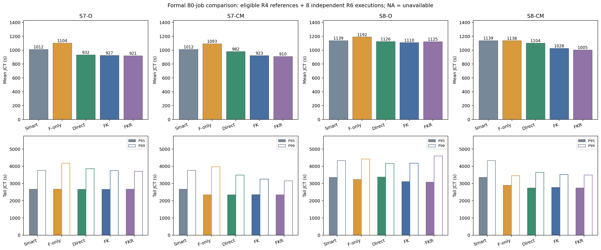
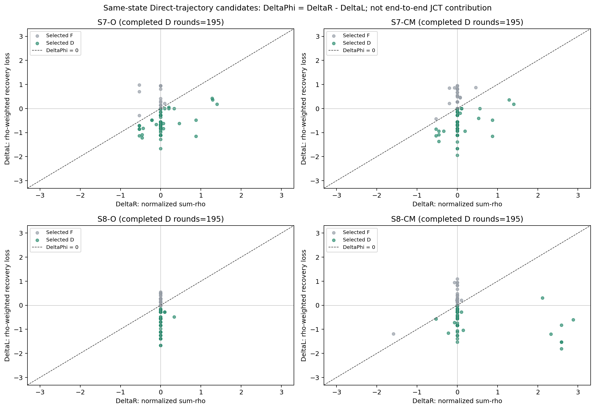
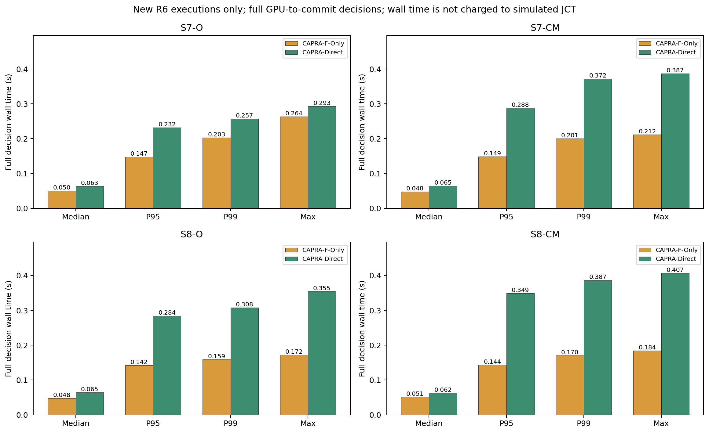

# CAPRA Direct R6：首批正式对照与机制分析


有效新正式单元 **8/8**；合格历史参照 **12/12**。R5算法基准`b40cdefdff27d46d8044510652a557e8d7599920`，R4来源`ffa953fb9cd12773992559512d85065bbd26b7b2`，实际执行HEAD `85d1c1b7c51f7d44f6abdfae5fe5663cc1d3c051`。最终交付提交与执行HEAD分开报告。本轮不自动push。


## 方法、工程接入与冻结


CAPRA-Direct正式决策直接调用原runner_direct_r5.decide，未复制或改写直接构造。CAPRA-F-Only只调用原DirectPlacement.prepare_f，以同一RepairAllocator形成完整F；spy验证未调用select/construct_d/can_finish/D_AFTER，D_status=NOT_APPLICABLE_F_ONLY，不算预算回退。两者从仿真起点独立初始化80作业、独立新进程闭环运行，每轮同一GpuStage一次、commit_v2一次；后续GPU序列允许随状态分化。Direct轨迹中的F不是F-only整条轨迹的反事实。


R5全部旧受控文件保持原字节；GPU MIP、batch、在线模型、真实锁/费用、画像、H180、周期60、seed0、单线程及5秒协作式预算保持。新入口补足FORMAL、完整80行、不进展/控制开销停止、进程树硬限和可移植只读复核。R5的零费用fixture将全部transition costs（含迁移）清零，准确称零转换成本机制测试，不属于本轮真实恢复费用下的性能证据。


## 20格来源与完整结果


NEW_EXECUTION_R6是本轮8格实际新运行；REUSED_R4只在逐格复用资格通过后进入比较。R4原版本、提交、目录、源码包、运行时间全部保留。Smart是冻结的Sia smart placement适配+比例配额，非官方完整系统原样复现；FK/FKR为原候选协议，F-only为优化辅助配额参考方案。方法自身定义差异不是核查失败。


|场景|方法|来源|执行/审计|提交/到达/完成|mean|median|P95|P99|makespan|
|---|---|---|---|---|---|---|---|---|---|
|saturn7_dense05_original|CAPRA-F-Only|NEW_EXECUTION_R6|COMPLETE/PASS|80/80/80|1103.84|969.50|2670.85|4177.30|11716.00|
|saturn7_dense05_original|CAPRA-Direct|NEW_EXECUTION_R6|COMPLETE/PASS|80/80/80|932.50|793.25|2665.85|3857.81|11716.00|
|saturn7_dense05_cm|CAPRA-Direct|NEW_EXECUTION_R6|COMPLETE/PASS|80/80/80|981.67|868.50|2348.80|3497.39|11716.00|
|saturn7_dense05_cm|CAPRA-F-Only|NEW_EXECUTION_R6|COMPLETE/PASS|80/80/80|1092.85|996.75|2348.30|3973.20|11716.00|
|saturn8_dense05_original|CAPRA-Direct|NEW_EXECUTION_R6|COMPLETE/PASS|80/80/80|1126.31|879.75|3380.90|4157.32|11671.00|
|saturn8_dense05_original|CAPRA-F-Only|NEW_EXECUTION_R6|COMPLETE/PASS|80/80/80|1191.55|965.25|3243.35|4424.01|11766.00|
|saturn8_dense05_cm|CAPRA-F-Only|NEW_EXECUTION_R6|COMPLETE/PASS|80/80/80|1137.83|974.00|2901.60|3455.60|11671.00|
|saturn8_dense05_cm|CAPRA-Direct|NEW_EXECUTION_R6|COMPLETE/PASS|80/80/80|1103.85|978.25|2743.25|3647.86|11671.00|
|saturn7_dense05_original|SIA-SMART-P|REUSED_R4|COMPLETE/PASS|80/80/80|1012.10|830.00|2672.05|3760.33|11902.00|
|saturn7_dense05_original|CAPRA-FK|REUSED_R4|COMPLETE/PASS|80/80/80|926.52|784.75|2665.85|3748.98|11716.00|
|saturn7_dense05_original|CAPRA-FKR|REUSED_R4|COMPLETE/PASS|80/80/80|920.69|741.25|2673.42|3704.24|11716.00|
|saturn7_dense05_cm|SIA-SMART-P|REUSED_R4|COMPLETE/PASS|80/80/80|1012.10|830.00|2672.05|3760.33|11902.00|
|saturn7_dense05_cm|CAPRA-FK|REUSED_R4|COMPLETE/PASS|80/80/80|922.92|771.00|2360.30|3256.69|11716.00|
|saturn7_dense05_cm|CAPRA-FKR|REUSED_R4|COMPLETE/PASS|80/80/80|909.85|766.50|2347.85|3152.41|11716.00|
|saturn8_dense05_original|SIA-SMART-P|REUSED_R4|COMPLETE/PASS|80/80/80|1138.89|869.50|3359.50|4329.72|11857.00|
|saturn8_dense05_original|CAPRA-FK|REUSED_R4|COMPLETE/PASS|80/80/80|1109.91|897.50|3113.45|4176.05|11671.00|
|saturn8_dense05_original|CAPRA-FKR|REUSED_R4|COMPLETE/PASS|80/80/80|1124.62|874.25|3089.70|4601.48|11671.00|
|saturn8_dense05_cm|SIA-SMART-P|REUSED_R4|COMPLETE/PASS|80/80/80|1138.89|869.50|3359.50|4329.72|11857.00|
|saturn8_dense05_cm|CAPRA-FK|REUSED_R4|COMPLETE/PASS|80/80/80|1027.99|850.25|2776.25|3525.69|11671.00|
|saturn8_dense05_cm|CAPRA-FKR|REUSED_R4|COMPLETE/PASS|80/80/80|1004.75|791.75|2743.95|3492.83|11671.00|


未完整80/80或审计未通过的总体JCT与makespan均留空，不用完成子集平均冒充总体。缺失/不合格原因在source_index.json与每格reuse_eligibility.json；未追加历史方法重跑。


## 同场景完整配对比较


改善率=100*(baseline-method)/baseline，正值表示更低耗时。相同作业ID/到达配对；F-only/Smart是参考放置+辅助配额优化系统的组合差异，不是只变CPU/RAM的严格单因素因果估计。


|场景|方法/基线|状态|mean改善%|P95改善%|P99改善%|快/平/慢|ratioP95/max|
|---|---|---|---|---|---|---|---|
|saturn7_dense05_original|CAPRA-Direct/CAPRA-F-Only|COMPARED|15.52|0.19|7.65|59/9/12|1.074/1.423|
|saturn7_dense05_original|CAPRA-F-Only/SIA-SMART-P|COMPARED|-9.06|0.04|-11.09|39/1/40|1.682/2.032|
|saturn7_dense05_original|CAPRA-Direct/SIA-SMART-P|COMPARED|7.86|0.23|-2.59|62/1/17|1.280/1.766|
|saturn7_dense05_original|CAPRA-Direct/CAPRA-FK|COMPARED|-0.64|0.00|-2.90|27/21/32|1.267/1.766|
|saturn7_dense05_original|CAPRA-Direct/CAPRA-FKR|COMPARED|-1.28|0.28|-4.15|27/16/37|1.319/1.766|
|saturn7_dense05_cm|CAPRA-Direct/CAPRA-F-Only|COMPARED|10.17|-0.02|11.98|49/8/23|1.263/1.331|
|saturn7_dense05_cm|CAPRA-F-Only/SIA-SMART-P|COMPARED|-7.98|12.12|-5.66|37/0/43|1.715/1.927|
|saturn7_dense05_cm|CAPRA-Direct/SIA-SMART-P|COMPARED|3.01|12.10|6.99|47/0/33|1.351/1.562|
|saturn7_dense05_cm|CAPRA-Direct/CAPRA-FK|COMPARED|-6.37|0.49|-7.39|20/16/44|1.397/1.562|
|saturn7_dense05_cm|CAPRA-Direct/CAPRA-FKR|COMPARED|-7.89|-0.04|-10.94|23/10/47|1.494/1.598|
|saturn8_dense05_original|CAPRA-Direct/CAPRA-F-Only|COMPARED|5.48|-4.24|6.03|48/1/31|1.381/1.566|
|saturn8_dense05_original|CAPRA-F-Only/SIA-SMART-P|COMPARED|-4.62|3.46|-2.18|37/0/43|1.494/1.651|
|saturn8_dense05_original|CAPRA-Direct/SIA-SMART-P|COMPARED|1.10|-0.64|3.98|45/0/35|1.421/1.744|
|saturn8_dense05_original|CAPRA-Direct/CAPRA-FK|COMPARED|-1.48|-8.59|0.45|35/5/40|1.384/1.662|
|saturn8_dense05_original|CAPRA-Direct/CAPRA-FKR|COMPARED|-0.15|-9.42|9.65|31/5/44|1.308/1.598|
|saturn8_dense05_cm|CAPRA-Direct/CAPRA-F-Only|COMPARED|2.99|5.46|-5.56|45/6/29|1.338/1.632|
|saturn8_dense05_cm|CAPRA-F-Only/SIA-SMART-P|COMPARED|0.09|13.63|20.19|34/1/45|1.451/1.784|
|saturn8_dense05_cm|CAPRA-Direct/SIA-SMART-P|COMPARED|3.08|18.34|15.75|44/0/36|1.446/1.547|
|saturn8_dense05_cm|CAPRA-Direct/CAPRA-FK|COMPARED|-7.38|1.19|-3.47|33/6/41|1.486/1.727|
|saturn8_dense05_cm|CAPRA-Direct/CAPRA-FKR|COMPARED|-9.86|0.03|-4.44|27/6/47|1.477/1.727|


配对JCT比值不是独占运行slowdown；没有多seed或置信区间。两个trace的两种画像条件不是四条独立生产样本，640次提交也不是640个独立研究样本。调度轮不是统计独立样本。





## 等待、训练、实际恢复与个体退化


|场景|方法/基线|平均等待差秒|平均训练差秒|平均实际恢复差秒|最差相对任务|最大绝对退化秒|
|---|---|---|---|---|---|---|
|saturn7_dense05_original|CAPRA-Direct/CAPRA-F-Only|-1.50|-96.21|-73.62|cifar10-44|318.00|
|saturn7_dense05_original|CAPRA-F-Only/SIA-SMART-P|0.00|20.99|70.75|cifar10-64|982.00|
|saturn7_dense05_original|CAPRA-Direct/SIA-SMART-P|-1.50|-75.22|-2.88|bert-47|691.00|
|saturn7_dense05_original|CAPRA-Direct/CAPRA-FK|-0.75|1.04|5.69|bert-47|691.00|
|saturn7_dense05_original|CAPRA-Direct/CAPRA|0.75|-2.81|13.88|bert-47|691.00|
|saturn7_dense05_cm|CAPRA-Direct/CAPRA-F-Only|-2.25|-57.55|-51.38|cifar10-79|399.00|
|saturn7_dense05_cm|CAPRA-F-Only/SIA-SMART-P|0.75|6.25|73.75|cifar10-91|875.00|
|saturn7_dense05_cm|CAPRA-Direct/SIA-SMART-P|-1.50|-51.30|22.38|bert-47|507.00|
|saturn7_dense05_cm|CAPRA-Direct/CAPRA-FK|1.50|30.00|27.25|bert-47|507.00|
|saturn7_dense05_cm|CAPRA-Direct/CAPRA|0.75|36.08|35.00|cifar10-117|562.00|
|saturn8_dense05_original|CAPRA-Direct/CAPRA-F-Only|-0.75|-30.18|-34.31|cifar10-30|570.00|
|saturn8_dense05_original|CAPRA-F-Only/SIA-SMART-P|2.25|1.16|49.25|cifar10-121|674.00|
|saturn8_dense05_original|CAPRA-Direct/SIA-SMART-P|1.50|-29.01|14.94|cifar10-74|740.00|
|saturn8_dense05_original|CAPRA-Direct/CAPRA-FK|-1.50|2.02|15.88|cifar10-74|861.00|
|saturn8_dense05_original|CAPRA-Direct/CAPRA|1.50|-14.19|14.38|cifar10-70|935.00|
|saturn8_dense05_cm|CAPRA-Direct/CAPRA-F-Only|0.75|-14.04|-20.69|deepspeech2-38|1920.00|
|saturn8_dense05_cm|CAPRA-F-Only/SIA-SMART-P|0.75|-59.94|58.12|cifar10-111|597.00|
|saturn8_dense05_cm|CAPRA-Direct/SIA-SMART-P|1.50|-73.97|37.44|cifar10-76|608.00|
|saturn8_dense05_cm|CAPRA-Direct/CAPRA-FK|0.75|37.99|37.12|cifar10-76|1563.00|
|saturn8_dense05_cm|CAPRA-Direct/CAPRA|0.75|53.04|45.31|cifar10-76|1561.00|


恢复汇总来自executions实际消耗，未把逐轮candidate.total_delay相加。逐方法首次start/resume、GPU类型/形状/组合变更、纯节点迁移（含batch合同一致）与aux-only更新分别记录于metrics.json。新费用总额与实际恢复消耗分开，跨轮remaining不重复当新费用。最大退化作业完整账本见worst_cases.json/paired_jobs.csv；预注册最大绝对退化案例含两条真实GPU/batch/配额/费用轨迹。整条轨迹差不是某单轮行动的严格因果效应。


## 精确机制：R、L与Phi


仅分析Direct轨迹完成D构造的非空轮：R=sum rho，L=sum rho*min(delay/180,1)，Phi=R-L，逐轮验证DeltaPhi=DeltaR-DeltaL。delay包含真实剩余恢复与本轮新增费用。sum rho是归一化画像收益之和，不是samples/s或JCT改善率。


|场景|非空轮|选D/F|D完成|F严格Phi|F评分近似平局规则|最终平局同/异布局|预算回退|
|---|---|---|---|---|---|---|---|
|saturn7_dense05_original|195|62/133|195|14|0|100/19|0|
|saturn7_dense05_cm|195|58/137|195|22|0|100/15|0|
|saturn8_dense05_original|195|48/147|195|20|0|109/18|0|
|saturn8_dense05_cm|195|54/141|195|20|0|108/13|0|


|场景|raw rho增加|总delay减少|R/delay同但Phi异|raw增益被恢复抵消|Phi更高但场景JCT未改|
|---|---|---|---|---|---|
|saturn7_dense05_original|13|53|2|1|0|
|saturn7_dense05_cm|13|50|2|3|0|
|saturn8_dense05_original|3|45|5|0|0|
|saturn8_dense05_cm|10|50|7|1|0|


上述标志可重叠，不能相加等于总数、相减推断遗漏；最后一列仅关联本场景整体JCT，不证明候选轮导致退化。未选D不等于没有任何理论优化机会；平局分完整Allocation相同与仅评分/费用相同，分层见mechanism_strata.csv。F-only的NOT_APPLICABLE不进入这些D回退计数。





## CPU与RAM作用


|场景|CPU单变增益/损失任务轮|RAM单变增益/损失任务轮|联合变化增益/损失|变化但rho不变|
|---|---|---|---|---|
|saturn7_dense05_original|62/61|0/0|0/0|195|
|saturn7_dense05_cm|63/51|1/0|0/0|272|
|saturn8_dense05_original|14/14|0/0|0/0|305|
|saturn8_dense05_cm|48/34|15/3|0/0|306|


CPU/RAM都变标联合变化，不拆成两者的JCT贡献百分比；只有配额变化而rho不变不记模型性能收益。共同分配器的实际训练加权RAM条件差在metrics.json/training_auxiliary_metrics；Direct额外放置的RAM单变/联合变化在quota_changes.csv，两者不混为一项。Original与CM是两种冻结组合响应条件，CM不是RAM单因素，也非真实硬件实测。


本轮观察到模型内RAM单独变化增益的任务轮，数量如表；这是同状态画像响应差，不等于独立RAM造成的端到端JCT贡献。


## 预注册典型案例


saturn7_dense05_original / FIRST_D_STRICT_PHI_GAIN：轮9，选D，DeltaR=0.000000、DeltaL=-0.145833、DeltaPhi=0.145833。GPU contract、完整节点/CPU/RAM/rho、真实锁与逐作业恢复费用完整保存在representative_cases.json。

saturn7_dense05_original / FIRST_RAW_GAIN_OFFSET_BY_RECOVERY：轮144，选F，DeltaR=0.100000、DeltaL=0.208333、DeltaPhi=-0.108333。GPU contract、完整节点/CPU/RAM/rho、真实锁与逐作业恢复费用完整保存在representative_cases.json。

saturn7_dense05_original / 最大绝对退化：`cifar10-76`，JCT 1005.00→1323.00秒；等待/训练/恢复差0.00/368.00/-50.00秒。两个闭环的后续轨迹已保留，不归因于单轮D行动。

saturn7_dense05_cm / FIRST_D_STRICT_PHI_GAIN：轮9，选D，DeltaR=0.000000、DeltaL=-0.145833、DeltaPhi=0.145833。GPU contract、完整节点/CPU/RAM/rho、真实锁与逐作业恢复费用完整保存在representative_cases.json。

saturn7_dense05_cm / FIRST_RAW_GAIN_OFFSET_BY_RECOVERY：轮31，选F，DeltaR=0.070000、DeltaL=0.444444、DeltaPhi=-0.374444。GPU contract、完整节点/CPU/RAM/rho、真实锁与逐作业恢复费用完整保存在representative_cases.json。

saturn7_dense05_cm / 最大绝对退化：`cifar10-79`，JCT 1206.00→1605.00秒；等待/训练/恢复差0.00/249.00/150.00秒。两个闭环的后续轨迹已保留，不归因于单轮D行动。

saturn8_dense05_original / FIRST_D_STRICT_PHI_GAIN：轮5，选D，DeltaR=0.000000、DeltaL=-0.180556、DeltaPhi=0.180556。GPU contract、完整节点/CPU/RAM/rho、真实锁与逐作业恢复费用完整保存在representative_cases.json。

saturn8_dense05_original / FIRST_RAW_GAIN_OFFSET_BY_RECOVERY：没有符合预注册规则的案例。

saturn8_dense05_original / 最大绝对退化：`cifar10-84`，JCT 1017.00→1587.00秒；等待/训练/恢复差0.00/520.00/50.00秒。两个闭环的后续轨迹已保留，不归因于单轮D行动。

saturn8_dense05_cm / FIRST_D_STRICT_PHI_GAIN：轮5，选D，DeltaR=0.000000、DeltaL=-0.180556、DeltaPhi=0.180556。GPU contract、完整节点/CPU/RAM/rho、真实锁与逐作业恢复费用完整保存在representative_cases.json。

saturn8_dense05_cm / FIRST_RAW_GAIN_OFFSET_BY_RECOVERY：轮18，选F，DeltaR=0.100000、DeltaL=0.208333、DeltaPhi=-0.108333。GPU contract、完整节点/CPU/RAM/rho、真实锁与逐作业恢复费用完整保存在representative_cases.json。

saturn8_dense05_cm / 最大绝对退化：`deepspeech2-38`，JCT 3036.50→4956.50秒；等待/训练/恢复差0.00/1920.00/0.00秒。两个闭环的后续轨迹已保留，不归因于单轮D行动。


## 开销与运行预算


|场景|方法|完整决策median/P95/P99/max秒|单元wall秒|原始独立审计秒|
|---|---|---|---|---|
|saturn7_dense05_original|CAPRA-F-Only|0.05033/0.14745/0.20310/0.26351|206.53|0.54|
|saturn7_dense05_original|CAPRA-Direct|0.06332/0.23170/0.25712/0.29286|213.70|2.22|
|saturn7_dense05_cm|CAPRA-Direct|0.06460/0.28811/0.37191/0.38690|217.81|2.49|
|saturn7_dense05_cm|CAPRA-F-Only|0.04816/0.14908/0.20068/0.21195|213.34|0.55|
|saturn8_dense05_original|CAPRA-Direct|0.06472/0.28406/0.30771/0.35457|229.83|2.87|
|saturn8_dense05_original|CAPRA-F-Only|0.04765/0.14200/0.15901/0.17231|214.23|0.57|
|saturn8_dense05_cm|CAPRA-F-Only|0.05087/0.14364/0.17011/0.18448|223.52|0.57|
|saturn8_dense05_cm|CAPRA-Direct|0.06222/0.34909/0.38668/0.40706|234.88|2.96|


总轮与非空轮分别记录；开销表主分位数为非空轮，完整GPU-to-commit区间含必要F reference/配额/构造/比较/commit及未单列杂项。F reference、F quota、D、GPU、commit与嵌套completion/allocator/scoring边界在metrics.json明确，不把嵌套区间相加。R4旧wall仅历史参考，不计算跨测量环境的快几倍。真实wall不加入模拟JCT。





本报告生成时共享窗口已用1957.31/5400秒，剩余约3442.69秒；最终以budget_ledger.json与final_verification.json为准。环境/定向验证合计<=300秒，历史资格核查<=120秒；每逻辑格所有attempt<=600秒、工作/审计<=570秒、清理预留30秒。每新格启动前要求至少600+180秒剩余。5秒候选协作预算、600秒单元硬限、90分钟全局窗口分别报告。最大观测wall低于周期也不构成硬实时保证。


预算状态采用Direct非空轮为分母，NOT_APPLICABLE_F_ONLY不计入：

|场景|非空轮|D未开始预算退出|D中途预算退出|候选wall超过5秒|协作检查调用数|
|---|---|---|---|---|---|
|saturn7_dense05_original|195|0|0|0|16365|
|saturn7_dense05_cm|195|0|0|0|17072|
|saturn8_dense05_original|195|0|0|0|19448|
|saturn8_dense05_cm|195|0|0|0|19102|


GPU/F参考/F配额/D/commit及嵌套阶段各自median/P95/P99/max与样本数完整输出于stage_overhead.csv；inclusive嵌套阶段不相加。

## 下一步只建议一项


下一步优先对本轮已记录的候选Phi与闭环JCT/尾部不一致案例做有限、预注册的受控验证，检验恢复加权局部代理与后续GPU反馈的错配；保留独立F-only对照和全部负结果，不直接扩大搜索或调整H。


正确实现、完整运行、性能改善分别评价。下降、尾部退化、RAM增益未出现和不可比项全部保留。本轮未做新oracle/布局枚举/调参/额外训练；两个trace同源派生、固定seed、单节点与每GPU类型至多两节点范围限制仍在。


## 复现与证据入口


运行源码包：`runs/direct_eval_r6/source_snapshot.zip`，SHA256 `41a62cb7465b8a0e35d6f24fb744844bb2d52c970f3e3f0a01f1eb4d36e3400a`；含GPU/训练性能CSV及传递源码，不只顶层Python。manifest与源码包没有自引用哈希循环。实际执行HEAD `85d1c1b7c51f7d44f6abdfae5fe5663cc1d3c051`，交付SHA由最后本地提交与回复提供。


- `DIRECT_EVAL_R6_README.md`：总入口。

- `configs/experiment_manifest_direct_eval_r6.json`：固定8格与全部来源/指标/停止合同。

- `runs/direct_eval_r6/matrix_ledger.json`、`budget_ledger.json`：所有单元/attempt/进程清理与实际wall。

- `historical_reuse/<scenario>/<method>/reuse_eligibility.json`：每格历史资格及原因。

- 本目录results/comparisons/paired_jobs/overhead/mechanism_rounds/quota_changes/representative_cases：表与案例。


在仓库根目录使用该环境（或匹配锁版本的新环境，PYTHONPATH指向当前src）：


```powershell

.\.venv\Scripts\python.exe -X utf8 -B scripts/run_direct_eval_r6.py --manifest configs/experiment_manifest_direct_eval_r6.json --resume

.\.venv\Scripts\python.exe -X utf8 -B scripts/verify_direct_eval_r6.py --manifest configs/experiment_manifest_direct_eval_r6.json

.\.venv\Scripts\python.exe -X utf8 -B scripts/report_direct_eval_r6.py --manifest configs/experiment_manifest_direct_eval_r6.json

```


verify/report不调用生产放置器、GPU MIP、Job.step，不枚举新布局；已有analysis时report写新analysis_rebuild目录，不覆盖封存原始数据。本轮自动复核/重建使用--budgeted并受原执行窗口约束，截止后不自动续算；用户以后显式手动只读复核是独立操作，不重置旧运行账本，也不启动新正式运行。


手动推送：`git -C "<本仓库路径>" push -u origin capra/direct-evaluation-r6`。本轮未推送。


执行源码与输入持续保持冻结字节。分析/报告工具的非执行修订另记tooling_revision_ledger.json，保留每次修改前的原字节及前后SHA；当前报告工具以最终交付Git树及该修订链为准，原运行源码包不覆盖。
