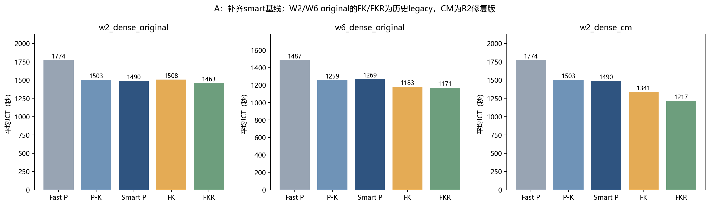
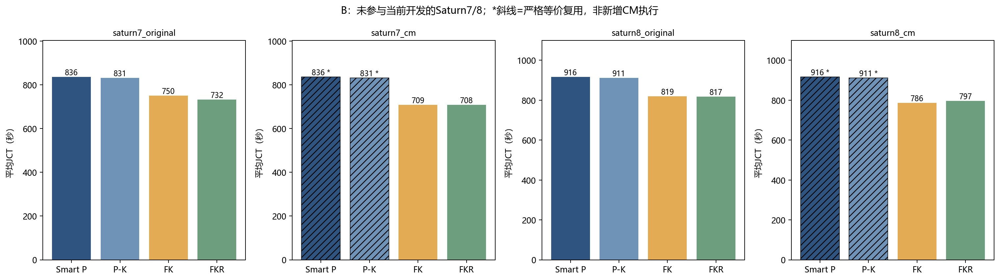
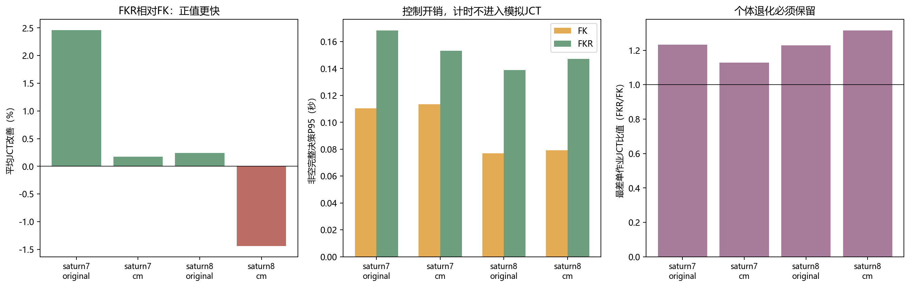

# CAPRA R3：smart基线与未使用负载验证结果

唯一基准 `0876dd916e1b25d2030233826968683da730a55f`；分支 `capra/smart-holdout-r3`，工作副本 `D:/科研启航/CAPRA-smart-holdout-r3`。新增物理正式完成 **15/15**，通过审计的完整新增作业 **1200/1200**，严格等价逻辑复用 **4/4**。历史引用另列，不算新增执行或独立样本。

建议下一轮以FK+ram_slack_v1为简洁主版本，保留冻结FKR作扩展强对照。R在四条件的平均JCT增量为+2.46%、+0.17%、+0.24%、−1.44%；三个条件增量很小或为负，Saturn7 original的P99还退化1.70%，而每个条件控制开销都增加。R2开发场景CM的9.21%未在这两条未使用负载中稳定延续；这不证明R无价值，也不自动删除R或加入新门控。当前控制耗时绝对值仍小，不能称不可用或过大。

## A：smart补齐后的基线变化

SIA-SMART-P是仓库内Sia smart placement在当前单节点、物理恢复锁和比例辅助资源模型下的适配基线，不等同官方完整系统。仅修正原smart排序引用jobname→x，保持稳定平局；有符号容量防护、空零规范和记录不改有效非空决策。GPU MIP/输入/配置/费用/锁保持；每个活动轮一次GPU MIP，无fast/K或辅助优化fallback。

|场景|方法|身份/分配器|完成/删失|mean|P50|P95|P99|makespan|
|---|---|---|---|---|---|---|---|---|
|w2_dense_original|SIA-SMART-P|NEW_EXECUTION/none|80/80; 0|1490.24|1078.00|5063.42|5808.15|10666.00|
|w2_dense_cm|SIA-SMART-P|NEW_EXECUTION/none|80/80; 0|1490.24|1078.00|5063.42|5808.15|10666.00|
|w6_dense_original|SIA-SMART-P|NEW_EXECUTION/none|80/80; 0|1269.22|921.00|3137.15|4542.48|11758.00|
|w2_dense_original|SIA-P|HISTORICAL_REFERENCE/none|80/80; 0|1774.46|1558.00|5257.32|6062.61|10895.00|
|w2_dense_original|CAPRA|HISTORICAL_REFERENCE/legacy|80/80; 0|1462.99|1168.50|5026.30|5400.93|10510.00|
|w6_dense_original|SIA-P|HISTORICAL_REFERENCE/none|80/80; 0|1487.47|1184.25|3613.57|5096.30|11740.00|
|w6_dense_original|CAPRA|HISTORICAL_REFERENCE/legacy|80/80; 0|1170.88|802.75|3213.37|4513.17|11636.00|
|w2_dense_cm|SIA-P|HISTORICAL_REFERENCE/none|80/80; 0|1774.46|1558.00|5257.32|6062.61|10895.00|
|w2_dense_original|SIA-P-K|HISTORICAL_REFERENCE/none|80/80; 0|1503.03|1156.00|5174.52|5872.26|10760.00|
|w2_dense_original|CAPRA-FK|HISTORICAL_REFERENCE/legacy|80/80; 0|1507.99|1289.25|4863.18|5571.44|10584.00|
|w6_dense_original|SIA-P-K|HISTORICAL_REFERENCE/none|80/80; 0|1258.82|876.00|3153.90|4617.23|11719.00|
|w6_dense_original|CAPRA-FK|HISTORICAL_REFERENCE/legacy|80/80; 0|1182.87|815.25|3244.37|4577.16|11620.00|
|w2_dense_cm|SIA-P-K|HISTORICAL_REFERENCE/none|80/80; 0|1503.03|1156.00|5174.52|5872.26|10760.00|
|w2_dense_cm|CAPRA-Fixed|HISTORICAL_REFERENCE/ram_slack_v1|80/80; 0|1507.79|1269.00|4604.52|5301.38|10578.00|
|w2_dense_cm|CAPRA-FK|HISTORICAL_REFERENCE/ram_slack_v1|80/80; 0|1340.78|1016.75|4233.40|4936.14|10669.00|
|w2_dense_cm|CAPRA|HISTORICAL_REFERENCE/ram_slack_v1|80/80; 0|1217.35|956.50|3603.17|4368.63|10662.00|

W2 original/CM smart完整语义控制：**PASS**，180轮，逐作业CSV字节一致；逐轮分配/位置、候选、锁、batch、费用、执行分段与进度严格一致，排除项见证书。

|场景|比较|mean改善%|P95改善%|P99改善%|版本说明|
|---|---|---|---|---|---|
|w2_dense_original|SIA-SMART-P/SIA-P|16.02|3.69|4.20|FK/FKR按源legacy/repair，不改标签|
|w2_dense_original|SIA-SMART-P/SIA-P-K|0.85|2.15|1.09|FK/FKR按源legacy/repair，不改标签|
|w2_dense_original|CAPRA-FK/SIA-SMART-P|-1.19|3.95|4.08|FK/FKR按源legacy/repair，不改标签|
|w2_dense_original|CAPRA/SIA-SMART-P|1.83|0.73|7.01|FK/FKR按源legacy/repair，不改标签|
|w2_dense_cm|SIA-SMART-P/SIA-P|16.02|3.69|4.20|FK/FKR按源legacy/repair，不改标签|
|w2_dense_cm|SIA-SMART-P/SIA-P-K|0.85|2.15|1.09|FK/FKR按源legacy/repair，不改标签|
|w2_dense_cm|CAPRA-FK/SIA-SMART-P|10.03|16.39|15.01|FK/FKR按源legacy/repair，不改标签|
|w2_dense_cm|CAPRA/SIA-SMART-P|18.31|28.84|24.78|FK/FKR按源legacy/repair，不改标签|
|w6_dense_original|SIA-SMART-P/SIA-P|14.67|13.18|10.87|FK/FKR按源legacy/repair，不改标签|
|w6_dense_original|SIA-SMART-P/SIA-P-K|-0.83|0.53|1.62|FK/FKR按源legacy/repair，不改标签|
|w6_dense_original|CAPRA-FK/SIA-SMART-P|6.80|-3.42|-0.76|FK/FKR按源legacy/repair，不改标签|
|w6_dense_original|CAPRA/SIA-SMART-P|7.75|-2.43|0.65|FK/FKR按源legacy/repair，不改标签|

## B：Saturn7/8泛化主比较

筛选与R2预登记源行号/hash一致：支持四应用、原请求GPU1..8、按原time再源行号取80，全部原字段和到达保留。Saturn7：71CIFAR/5DS/4BERT，225–22771秒；Saturn8：71CIFAR/8DS/1BERT，90–22529秒。未压缩到达、未按性能选数据。两个同Saturn来源族负载，称未参与当前开发的负载验证；不是跨多来源生产验证。original/CM为冻结受控响应，跨环境改变多项响应，非严格RAM单因素消融。

|场景|方法|身份|完成/删失|mean|P50|P95|P99|makespan|
|---|---|---|---|---|---|---|---|---|
|saturn7_supported80_original|SIA-SMART-P|NEW_EXECUTION|80/80; 0|835.66|682.50|2666.00|2805.14|23182.00|
|saturn7_supported80_original|SIA-P-K|NEW_EXECUTION|80/80; 0|830.76|680.00|2666.40|2805.14|23182.00|
|saturn7_supported80_original|CAPRA-FK|NEW_EXECUTION|80/80; 0|750.48|570.50|2742.90|2781.60|22996.00|
|saturn7_supported80_original|CAPRA|NEW_EXECUTION|80/80; 0|732.00|579.00|2742.90|2829.00|22996.00|
|saturn7_supported80_cm|CAPRA-FK|NEW_EXECUTION|80/80; 0|708.71|568.50|2378.85|2628.70|22996.00|
|saturn7_supported80_cm|CAPRA|NEW_EXECUTION|80/80; 0|707.50|563.50|2378.85|2628.70|22996.00|
|saturn8_supported80_original|CAPRA|NEW_EXECUTION|80/80; 0|816.88|598.00|2777.30|2903.55|22891.00|
|saturn8_supported80_original|CAPRA-FK|NEW_EXECUTION|80/80; 0|818.85|608.00|2784.65|2943.84|22891.00|
|saturn8_supported80_original|SIA-P-K|NEW_EXECUTION|80/80; 0|911.46|661.50|2793.45|3001.01|23077.00|
|saturn8_supported80_original|SIA-SMART-P|NEW_EXECUTION|80/80; 0|916.36|675.00|2817.20|2950.45|23077.00|
|saturn8_supported80_cm|CAPRA|NEW_EXECUTION|80/80; 0|796.90|598.00|2651.35|2693.50|22891.00|
|saturn8_supported80_cm|CAPRA-FK|NEW_EXECUTION|80/80; 0|785.60|593.50|2651.30|2709.30|22891.00|
|saturn7_supported80_cm|SIA-SMART-P|EQUIVALENCE_REUSED|80/80; 0|835.66|682.50|2666.00|2805.14|23182.00|
|saturn7_supported80_cm|SIA-P-K|EQUIVALENCE_REUSED|80/80; 0|830.76|680.00|2666.40|2805.14|23182.00|
|saturn8_supported80_cm|SIA-SMART-P|EQUIVALENCE_REUSED|80/80; 0|916.36|675.00|2817.20|2950.45|23077.00|
|saturn8_supported80_cm|SIA-P-K|EQUIVALENCE_REUSED|80/80; 0|911.46|661.50|2793.45|3001.01|23077.00|

|场景|比较|mean改善%|P95改善%|P99改善%|makespan改善%|
|---|---|---|---|---|---|
|saturn7_supported80_original|CAPRA/SIA-SMART-P|12.40|-2.88|-0.85|0.80|
|saturn7_supported80_original|CAPRA-FK/SIA-SMART-P|10.19|-2.88|0.84|0.80|
|saturn7_supported80_original|CAPRA-FK/SIA-P-K|9.66|-2.87|0.84|0.80|
|saturn7_supported80_original|CAPRA/SIA-P-K|11.89|-2.87|-0.85|0.80|
|saturn7_supported80_original|CAPRA/CAPRA-FK|2.46|0.00|-1.70|0.00|
|saturn7_supported80_original|SIA-SMART-P/SIA-P-K|-0.59|0.02|0.00|0.00|
|saturn7_supported80_cm|CAPRA/SIA-SMART-P|15.34|10.77|6.29|0.80|
|saturn7_supported80_cm|CAPRA-FK/SIA-SMART-P|15.19|10.77|6.29|0.80|
|saturn7_supported80_cm|CAPRA-FK/SIA-P-K|14.69|10.78|6.29|0.80|
|saturn7_supported80_cm|CAPRA/SIA-P-K|14.84|10.78|6.29|0.80|
|saturn7_supported80_cm|CAPRA/CAPRA-FK|0.17|0.00|0.00|0.00|
|saturn7_supported80_cm|SIA-SMART-P/SIA-P-K|-0.59|0.02|0.00|0.00|
|saturn8_supported80_original|CAPRA/SIA-SMART-P|10.86|1.42|1.59|0.81|
|saturn8_supported80_original|CAPRA-FK/SIA-SMART-P|10.64|1.16|0.22|0.81|
|saturn8_supported80_original|CAPRA-FK/SIA-P-K|10.16|0.32|1.91|0.81|
|saturn8_supported80_original|CAPRA/SIA-P-K|10.38|0.58|3.25|0.81|
|saturn8_supported80_original|CAPRA/CAPRA-FK|0.24|0.26|1.37|0.00|
|saturn8_supported80_original|SIA-SMART-P/SIA-P-K|-0.54|-0.85|1.68|0.00|
|saturn8_supported80_cm|CAPRA/SIA-SMART-P|13.04|5.89|8.71|0.81|
|saturn8_supported80_cm|CAPRA-FK/SIA-SMART-P|14.27|5.89|8.17|0.81|
|saturn8_supported80_cm|CAPRA-FK/SIA-P-K|13.81|5.09|9.72|0.81|
|saturn8_supported80_cm|CAPRA/SIA-P-K|12.57|5.09|10.25|0.81|
|saturn8_supported80_cm|CAPRA/CAPRA-FK|-1.44|-0.00|0.58|0.00|
|saturn8_supported80_cm|SIA-SMART-P/SIA-P-K|-0.54|-0.85|1.68|0.00|

改善率=100×(1−method/baseline)，正为更快。全部比较在同画像下；比例方法allocator none是其合同，FK/FKR统一ram_slack_v1。CM比例逻辑格仅通过严格比例点/代码依赖/归纳证明/R2控制/A控制/源完整审计后复用，不复制原始日志；wall与组件计时只引用源original观测。条件资源诊断按目标CM重新只读计算，不冒充新执行。

## 尾部、个体退化与时间账本

|场景|比较|快/平/慢|比值P95/max|最差比值作业|增加秒|Δ等待/训练/恢复|
|---|---|---|---|---|---|---|
|w2_dense_original|SIA-SMART-P/SIA-P|64/10/6|1.086/1.193|cifar10-36|131.00|-27.00/-131.22/-126.00|
|w2_dense_original|SIA-SMART-P/SIA-P-K|35/19/26|1.166/1.504|cifar10-91|602.00|2.25/-16.41/1.38|
|w2_dense_original|CAPRA-FK/SIA-SMART-P|35/6/39|1.433/1.753|cifar10-100|763.00|-1.50/8.69/10.56|
|w2_dense_original|CAPRA/SIA-SMART-P|48/3/29|1.339/1.652|cifar10-100|661.00|-4.50/-3.88/-18.88|
|w2_dense_cm|SIA-SMART-P/SIA-P|64/10/6|1.086/1.193|cifar10-36|131.00|-27.00/-131.22/-126.00|
|w2_dense_cm|SIA-SMART-P/SIA-P-K|35/19/26|1.166/1.504|cifar10-91|602.00|2.25/-16.41/1.38|
|w2_dense_cm|CAPRA-FK/SIA-SMART-P|54/1/25|1.210/1.483|cifar10-69|467.00|-3.00/-151.78/5.31|
|w2_dense_cm|CAPRA/SIA-SMART-P|68/1/11|1.046/1.275|cifar10-100|279.00|0.00/-270.33/-2.56|
|w6_dense_original|SIA-SMART-P/SIA-P|56/9/15|1.188/1.502|cifar10-49|326.00|1.50/-87.38/-132.38|
|w6_dense_original|SIA-SMART-P/SIA-P-K|34/10/36|1.266/1.640|cifar10-68|730.00|3.00/9.77/-2.38|
|w6_dense_original|CAPRA-FK/SIA-SMART-P|64/0/16|1.102/1.388|cifar10-73|514.00|-0.75/-102.66/17.06|
|w6_dense_original|CAPRA/SIA-SMART-P|62/0/18|1.086/1.167|deepspeech2-32|603.00|-4.50/-97.40/3.56|
|saturn7_supported80_original|CAPRA/SIA-SMART-P|70/1/9|1.068/1.157|cifar10-67|120.00|0.00/-79.66/-24.00|
|saturn7_supported80_original|CAPRA-FK/SIA-SMART-P|64/0/16|1.147/1.312|cifar10-68|263.00|0.00/-73.69/-11.50|
|saturn7_supported80_original|CAPRA-FK/SIA-P-K|62/2/16|1.175/1.312|cifar10-68|263.00|0.00/-73.41/-6.88|
|saturn7_supported80_original|CAPRA/SIA-P-K|66/2/12|1.068/1.157|cifar10-67|120.00|0.00/-79.39/-19.38|
|saturn7_supported80_original|CAPRA/CAPRA-FK|20/49/11|1.028/1.232|cifar10-76|157.00|0.00/-5.98/-12.50|
|saturn7_supported80_original|SIA-SMART-P/SIA-P-K|12/58/10|1.166/1.181|cifar10-66|139.00|0.00/0.27/4.62|
|saturn7_supported80_cm|CAPRA/SIA-SMART-P|74/1/5|1.020/1.141|cifar10-63|108.00|0.00/-97.60/-30.56|
|saturn7_supported80_cm|CAPRA-FK/SIA-SMART-P|74/2/4|1.001/1.141|cifar10-63|108.00|0.00/-97.01/-29.94|
|saturn7_supported80_cm|CAPRA-FK/SIA-P-K|70/3/7|1.023/1.141|cifar10-63|108.00|0.00/-96.74/-25.31|
|saturn7_supported80_cm|CAPRA/SIA-P-K|70/2/8|1.045/1.141|cifar10-63|108.00|0.00/-97.33/-25.94|
|saturn7_supported80_cm|CAPRA/CAPRA-FK|9/65/6|1.010/1.129|cifar10-81|88.00|0.00/-0.59/-0.62|
|saturn7_supported80_cm|SIA-SMART-P/SIA-P-K|12/58/10|1.166/1.181|cifar10-66|139.00|0.00/0.27/4.62|
|saturn8_supported80_original|CAPRA/SIA-SMART-P|73/0/7|1.017/1.114|bert-129|102.00|0.00/-77.86/-21.62|
|saturn8_supported80_original|CAPRA-FK/SIA-SMART-P|70/0/10|1.023/1.114|bert-129|102.00|0.00/-71.82/-25.69|
|saturn8_supported80_original|CAPRA-FK/SIA-P-K|70/1/9|1.028/1.117|cifar10-83|75.00|0.00/-70.36/-22.25|
|saturn8_supported80_original|CAPRA/SIA-P-K|67/1/12|1.089/1.175|cifar10-72|113.00|0.00/-76.40/-18.19|
|saturn8_supported80_original|CAPRA/CAPRA-FK|11/56/13|1.085/1.228|cifar10-72|141.00|0.00/-6.04/4.06|
|saturn8_supported80_original|SIA-SMART-P/SIA-P-K|18/48/14|1.135/1.218|cifar10-72|141.00|0.00/1.46/3.44|
|saturn8_supported80_cm|CAPRA/SIA-SMART-P|71/0/9|1.075/1.157|cifar10-76|120.00|0.00/-98.15/-21.31|
|saturn8_supported80_cm|CAPRA-FK/SIA-SMART-P|76/0/4|0.996/1.114|bert-129|102.00|0.00/-101.01/-29.75|
|saturn8_supported80_cm|CAPRA-FK/SIA-P-K|75/0/5|1.023/1.125|cifar10-95|79.00|0.00/-99.55/-26.31|
|saturn8_supported80_cm|CAPRA/SIA-P-K|72/0/8|1.083/1.226|cifar10-86|152.00|0.00/-96.69/-17.88|
|saturn8_supported80_cm|CAPRA/CAPRA-FK|9/53/18|1.197/1.315|cifar10-84|204.00|0.00/2.86/8.44|
|saturn8_supported80_cm|SIA-SMART-P/SIA-P-K|18/48/14|1.135/1.218|cifar10-72|141.00|0.00/1.46/3.44|

最大相对退化：w2_dense_original，CAPRA-FK/SIA-SMART-P，`cifar10-100`，JCT 1013.50→1776.50秒，比值1.753，增加763.00秒；等待/训练/恢复差为180.00/533.00/50.00秒。

最大绝对退化：w2_dense_original，CAPRA-FK/SIA-SMART-P，`deepspeech2-34`，JCT 4469.00→5436.00秒，比值1.216，增加967.00秒；等待/训练/恢复差为0.00/842.00/125.00秒。

比值是相对基线同作业JCT，不是经典独占slowdown。mean改善不意味着makespan/吞吐同比改善。时间账本差不作严格组件因果归因。

|场景/方法/身份|平均等待|平均训练|平均恢复|三项和/mean|
|---|---|---|---|---|
|w2_dense_original/SIA-SMART-P/NEW_EXECUTION|42.52|1237.59|210.12|1490.24/1490.24|
|w2_dense_cm/SIA-SMART-P/NEW_EXECUTION|42.52|1237.59|210.12|1490.24/1490.24|
|w6_dense_original/SIA-SMART-P/NEW_EXECUTION|37.22|1011.69|220.31|1269.22/1269.22|
|saturn7_supported80_original/SIA-SMART-P/NEW_EXECUTION|29.23|589.88|216.56|835.66/835.66|
|saturn7_supported80_original/SIA-P-K/NEW_EXECUTION|29.23|589.60|211.94|830.76/830.76|
|saturn7_supported80_original/CAPRA-FK/NEW_EXECUTION|29.23|516.19|205.06|750.48/750.48|
|saturn7_supported80_original/CAPRA/NEW_EXECUTION|29.23|510.21|192.56|732.00/732.00|
|saturn7_supported80_cm/CAPRA-FK/NEW_EXECUTION|29.23|492.86|186.62|708.71/708.71|
|saturn7_supported80_cm/CAPRA/NEW_EXECUTION|29.23|492.27|186.00|707.50/707.50|
|saturn8_supported80_original/CAPRA/NEW_EXECUTION|29.62|604.06|183.19|816.88/816.88|
|saturn8_supported80_original/CAPRA-FK/NEW_EXECUTION|29.62|610.10|179.12|818.85/818.85|
|saturn8_supported80_original/SIA-P-K/NEW_EXECUTION|29.62|680.46|201.38|911.46/911.46|
|saturn8_supported80_original/SIA-SMART-P/NEW_EXECUTION|29.62|681.92|204.81|916.36/916.36|
|saturn8_supported80_cm/CAPRA/NEW_EXECUTION|29.62|583.77|183.50|796.90/796.90|
|saturn8_supported80_cm/CAPRA-FK/NEW_EXECUTION|29.62|580.91|175.06|785.60/785.60|
|w2_dense_original/SIA-P/HISTORICAL_REFERENCE|69.53|1368.81|336.12|1774.46/1774.46|
|w2_dense_original/CAPRA/HISTORICAL_REFERENCE|38.02|1233.71|191.25|1462.99/1462.99|
|w6_dense_original/SIA-P/HISTORICAL_REFERENCE|35.72|1099.06|352.69|1487.47/1487.47|
|w6_dense_original/CAPRA/HISTORICAL_REFERENCE|32.72|914.29|223.88|1170.88/1170.88|
|w2_dense_cm/SIA-P/HISTORICAL_REFERENCE|69.53|1368.81|336.12|1774.46/1774.46|
|w2_dense_original/SIA-P-K/HISTORICAL_REFERENCE|40.27|1254.00|208.75|1503.03/1503.03|
|w2_dense_original/CAPRA-FK/HISTORICAL_REFERENCE|41.02|1246.28|220.69|1507.99/1507.99|
|w6_dense_original/SIA-P-K/HISTORICAL_REFERENCE|34.22|1001.91|222.69|1258.82/1258.82|
|w6_dense_original/CAPRA-FK/HISTORICAL_REFERENCE|36.47|909.02|237.38|1182.87/1182.87|
|w2_dense_cm/SIA-P-K/HISTORICAL_REFERENCE|40.27|1254.00|208.75|1503.03/1503.03|
|w2_dense_cm/CAPRA-Fixed/HISTORICAL_REFERENCE|42.52|1155.51|309.75|1507.79/1507.79|
|w2_dense_cm/CAPRA-FK/HISTORICAL_REFERENCE|39.52|1085.81|215.44|1340.78/1340.78|
|w2_dense_cm/CAPRA/HISTORICAL_REFERENCE|42.52|967.26|207.56|1217.35/1217.35|
|saturn7_supported80_cm/SIA-SMART-P/EQUIVALENCE_REUSED|29.23|589.88|216.56|835.66/835.66|
|saturn7_supported80_cm/SIA-P-K/EQUIVALENCE_REUSED|29.23|589.60|211.94|830.76/830.76|
|saturn8_supported80_cm/SIA-SMART-P/EQUIVALENCE_REUSED|29.62|681.92|204.81|916.36/916.36|
|saturn8_supported80_cm/SIA-P-K/EQUIVALENCE_REUSED|29.62|680.46|201.38|911.46/911.46|

## 控制开销与smart修复

|场景/方法/身份|median/P95/max秒|>5秒|格wall秒|计时来源|
|---|---|---|---|---|
|w2_dense_original/SIA-SMART-P/NEW_EXECUTION|0.0826/0.2248/0.3158|0|268.95|Measured current physical execution|
|w2_dense_cm/SIA-SMART-P/NEW_EXECUTION|0.0822/0.2221/0.4104|0|285.93|Measured current physical execution|
|w6_dense_original/SIA-SMART-P/NEW_EXECUTION|0.0602/0.1830/0.2873|0|264.33|Measured current physical execution|
|saturn7_supported80_original/SIA-SMART-P/NEW_EXECUTION|0.0379/0.0980/0.1823|0|312.54|Measured current physical execution|
|saturn7_supported80_original/SIA-P-K/NEW_EXECUTION|0.0371/0.0855/0.2221|0|315.21|Measured current physical execution|
|saturn7_supported80_original/CAPRA-FK/NEW_EXECUTION|0.0424/0.1105/0.2038|0|301.20|Measured current physical execution|
|saturn7_supported80_original/CAPRA/NEW_EXECUTION|0.0512/0.1682/0.3635|0|315.81|Measured current physical execution|
|saturn7_supported80_cm/CAPRA-FK/NEW_EXECUTION|0.0429/0.1134/0.1670|0|301.41|Measured current physical execution|
|saturn7_supported80_cm/CAPRA/NEW_EXECUTION|0.0463/0.1531/0.2863|0|295.12|Measured current physical execution|
|saturn8_supported80_original/CAPRA/NEW_EXECUTION|0.0494/0.1388/0.2480|0|291.01|Measured current physical execution|
|saturn8_supported80_original/CAPRA-FK/NEW_EXECUTION|0.0411/0.0770/0.1285|0|270.17|Measured current physical execution|
|saturn8_supported80_original/SIA-P-K/NEW_EXECUTION|0.0384/0.0720/0.1775|0|295.47|Measured current physical execution|
|saturn8_supported80_original/SIA-SMART-P/NEW_EXECUTION|0.0392/0.0821/0.2285|0|330.18|Measured current physical execution|
|saturn8_supported80_cm/CAPRA/NEW_EXECUTION|0.0532/0.1472/0.2508|0|310.49|Measured current physical execution|
|saturn8_supported80_cm/CAPRA-FK/NEW_EXECUTION|0.0403/0.0791/0.1771|0|280.40|Measured current physical execution|
|w2_dense_original/SIA-P/HISTORICAL_REFERENCE|0.0661/0.1699/0.3263|0|190.45|Historical source observed; missing component fields unavailable|
|w2_dense_original/CAPRA/HISTORICAL_REFERENCE|0.1168/3.2497/3.4523|0|295.97|Historical source observed; missing component fields unavailable|
|w6_dense_original/SIA-P/HISTORICAL_REFERENCE|0.0511/0.2272/0.3347|0|241.64|Historical source observed; missing component fields unavailable|
|w6_dense_original/CAPRA/HISTORICAL_REFERENCE|0.1040/2.3473/3.6162|0|311.70|Historical source observed; missing component fields unavailable|
|w2_dense_cm/SIA-P/HISTORICAL_REFERENCE|0.0649/0.1819/0.3278|0|206.59|Historical source observed; missing component fields unavailable|
|w2_dense_original/SIA-P-K/HISTORICAL_REFERENCE|0.0792/0.2113/0.3847|0|253.21|Historical source observed; missing component fields unavailable|
|w2_dense_original/CAPRA-FK/HISTORICAL_REFERENCE|0.0907/0.2847/0.4679|0|234.91|Historical source observed; missing component fields unavailable|
|w6_dense_original/SIA-P-K/HISTORICAL_REFERENCE|0.0627/0.1910/0.3357|0|271.70|Historical source observed; missing component fields unavailable|
|w6_dense_original/CAPRA-FK/HISTORICAL_REFERENCE|0.0707/0.2356/0.3367|0|275.74|Historical source observed; missing component fields unavailable|
|w2_dense_cm/SIA-P-K/HISTORICAL_REFERENCE|0.0756/0.2164/0.3964|0|252.12|Historical source observed; missing component fields unavailable|
|w2_dense_cm/CAPRA-Fixed/HISTORICAL_REFERENCE|0.0908/0.2712/0.4683|0|246.98|Historical source observed; missing component fields unavailable|
|w2_dense_cm/CAPRA-FK/HISTORICAL_REFERENCE|0.0870/0.2822/0.3905|0|256.98|Historical source observed; missing component fields unavailable|
|w2_dense_cm/CAPRA/HISTORICAL_REFERENCE|0.1184/3.0184/3.5540|0|359.09|Historical source observed; missing component fields unavailable|
|saturn7_supported80_cm/SIA-SMART-P/EQUIVALENCE_REUSED|0.0379/0.0980/0.1823|0|312.54|Source original observed/reused; no CM timing measurement|
|saturn7_supported80_cm/SIA-P-K/EQUIVALENCE_REUSED|0.0371/0.0855/0.2221|0|315.21|Source original observed/reused; no CM timing measurement|
|saturn8_supported80_cm/SIA-SMART-P/EQUIVALENCE_REUSED|0.0392/0.0821/0.2285|0|330.18|Source original observed/reused; no CM timing measurement|
|saturn8_supported80_cm/SIA-P-K/EQUIVALENCE_REUSED|0.0384/0.0720/0.1775|0|295.47|Source original observed/reused; no CM timing measurement|

完整决策边界含GPU准备/MIP、参考映射、候选及commit。候选F/K/R含配额/身份稳定/评分，RAM与mapping/scoring嵌套其中，不能再相加或机械相减。smart计时为物理放置，包含在共同GPU阶段；历史缺失组件为不可得。全部轮/非空轮分别保存在metrics.json。

|场景/Smart身份|非空轮|原保留作业轮|驱逐事件|见证修复轮/比例|受影响作业轮|
|---|---|---|---|---|---|
|w2_dense_original/NEW_EXECUTION|178|1608|18|2/1.12%|10|
|w2_dense_cm/NEW_EXECUTION|178|1608|18|2/1.12%|10|
|w6_dense_original/NEW_EXECUTION|196|1332|14|1/0.51%|5|
|saturn7_supported80_original/NEW_EXECUTION|344|775|8|1/0.29%|4|
|saturn8_supported80_original/NEW_EXECUTION|350|872|7|0/0.00%|0|
|saturn7_supported80_cm/EQUIVALENCE_REUSED|344|775|8|1/0.29%|4|
|saturn8_supported80_cm/EQUIVALENCE_REUSED|350|872|7|0/0.00%|0|

共同物理见证修复不是smart原生能力，具体作业、raw/修复/身份交换逐轮索引见各格smart_timeline.json和原始事件。若修复频繁，结论仅适用于此锁适配基线，不能归功于原smart。

## 机制、资源机会与每应用

|场景/方法/身份|训练加权rho|rho/rho_prop|超比例训练%|CPU正条件%|RAM正条件%|RAM接受步骤/实际选中更新|终局RAM机会轮|
|---|---|---|---|---|---|---|---|
|w2_dense_original/SIA-SMART-P/NEW_EXECUTION|1.0000|1.0000|0.00|0.00|0.00|0/不可得|0|
|w2_dense_cm/SIA-SMART-P/NEW_EXECUTION|1.0000|1.0000|0.00|0.00|0.00|0/不可得|28|
|w6_dense_original/SIA-SMART-P/NEW_EXECUTION|1.0000|1.0000|0.00|0.00|0.00|0/不可得|0|
|saturn7_supported80_original/SIA-SMART-P/NEW_EXECUTION|1.0000|1.0000|0.00|0.00|0.00|0/不可得|0|
|saturn7_supported80_original/SIA-P-K/NEW_EXECUTION|1.0000|1.0000|0.00|0.00|0.00|0/不可得|0|
|saturn7_supported80_original/CAPRA-FK/NEW_EXECUTION|1.2684|1.2684|27.51|27.51|0.00|0/0|0|
|saturn7_supported80_original/CAPRA/NEW_EXECUTION|1.2835|1.2835|29.13|29.13|0.00|0/0|0|
|saturn7_supported80_cm/CAPRA-FK/NEW_EXECUTION|1.3415|1.3415|35.49|31.73|3.77|2/1|0|
|saturn7_supported80_cm/CAPRA/NEW_EXECUTION|1.3405|1.3405|35.25|31.48|3.77|2/1|0|
|saturn8_supported80_original/CAPRA/NEW_EXECUTION|1.2097|1.2097|22.41|22.41|0.00|0/0|0|
|saturn8_supported80_original/CAPRA-FK/NEW_EXECUTION|1.1998|1.1998|20.98|20.98|0.00|0/0|0|
|saturn8_supported80_original/SIA-P-K/NEW_EXECUTION|1.0000|1.0000|0.00|0.00|0.00|0/不可得|0|
|saturn8_supported80_original/SIA-SMART-P/NEW_EXECUTION|1.0000|1.0000|0.00|0.00|0.00|0/不可得|0|
|saturn8_supported80_cm/CAPRA/NEW_EXECUTION|1.2541|1.2541|26.95|23.15|3.80|2/2|0|
|saturn8_supported80_cm/CAPRA-FK/NEW_EXECUTION|1.2676|1.2676|28.49|24.67|3.82|2/2|0|
|w2_dense_original/SIA-P/HISTORICAL_REFERENCE|1.0000|1.0000|0.00|0.00|0.00|0/不可得|0|
|w2_dense_original/CAPRA/HISTORICAL_REFERENCE|1.0513|1.0513|7.56|7.56|0.00|0/不可得|0|
|w6_dense_original/SIA-P/HISTORICAL_REFERENCE|1.0000|1.0000|0.00|0.00|0.00|0/不可得|0|
|w6_dense_original/CAPRA/HISTORICAL_REFERENCE|1.0973|1.0973|15.86|15.86|0.00|0/不可得|0|
|w2_dense_cm/SIA-P/HISTORICAL_REFERENCE|1.0000|1.0000|0.00|0.00|0.00|0/不可得|31|
|w2_dense_original/SIA-P-K/HISTORICAL_REFERENCE|1.0000|1.0000|0.00|0.00|0.00|0/不可得|0|
|w2_dense_original/CAPRA-FK/HISTORICAL_REFERENCE|1.0507|1.0507|7.75|7.75|0.00|0/不可得|0|
|w6_dense_original/SIA-P-K/HISTORICAL_REFERENCE|1.0000|1.0000|0.00|0.00|0.00|0/不可得|0|
|w6_dense_original/CAPRA-FK/HISTORICAL_REFERENCE|1.0969|1.0969|15.16|15.16|0.00|0/不可得|0|
|w2_dense_cm/SIA-P-K/HISTORICAL_REFERENCE|1.0000|1.0000|0.00|0.00|0.00|0/不可得|23|
|w2_dense_cm/CAPRA-Fixed/HISTORICAL_REFERENCE|1.1492|1.1492|22.06|14.40|7.65|27/27|0|
|w2_dense_cm/CAPRA-FK/HISTORICAL_REFERENCE|1.1466|1.1466|21.50|14.70|6.80|41/27|0|
|w2_dense_cm/CAPRA/HISTORICAL_REFERENCE|1.2692|1.2692|39.90|26.03|13.87|171/30|0|
|saturn7_supported80_cm/SIA-SMART-P/EQUIVALENCE_REUSED|1.0000|1.0000|0.00|0.00|0.00|0/不可得|33|
|saturn7_supported80_cm/SIA-P-K/EQUIVALENCE_REUSED|1.0000|1.0000|0.00|0.00|0.00|0/不可得|33|
|saturn8_supported80_cm/SIA-SMART-P/EQUIVALENCE_REUSED|1.0000|1.0000|0.00|0.00|0.00|0/不可得|33|
|saturn8_supported80_cm/SIA-P-K/EQUIVALENCE_REUSED|1.0000|1.0000|0.00|0.00|0.00|0/不可得|34|

|场景/方法|F/K/R或P选择|可行|纯节点迁移|GPU配置变化|aux更新|实际恢复秒|
|---|---|---|---|---|---|---|
|w2_dense_original/SIA-SMART-P/NEW_EXECUTION|{'P': 178}|{'P': 178}|22|261|0|16810.00|
|w2_dense_cm/SIA-SMART-P/NEW_EXECUTION|{'P': 178}|{'P': 178}|22|261|0|16810.00|
|w6_dense_original/SIA-SMART-P/NEW_EXECUTION|{'P': 196}|{'P': 196}|16|257|0|17625.00|
|saturn7_supported80_original/SIA-SMART-P/NEW_EXECUTION|{'P': 344}|{'P': 344}|7|255|0|17325.00|
|saturn7_supported80_original/SIA-P-K/NEW_EXECUTION|{'F': 314, 'K': 30}|{'F': 344, 'K': 336}|8|248|0|16955.00|
|saturn7_supported80_original/CAPRA-FK/NEW_EXECUTION|{'F': 303, 'K': 20}|{'F': 323, 'K': 311}|18|226|52|16405.00|
|saturn7_supported80_original/CAPRA/NEW_EXECUTION|{'F': 291, 'K': 28, 'R': 2}|{'F': 321, 'K': 312, 'R': 321}|12|213|57|15405.00|
|saturn7_supported80_cm/CAPRA-FK/NEW_EXECUTION|{'F': 298, 'K': 19}|{'F': 317, 'K': 311}|12|201|55|14930.00|
|saturn7_supported80_cm/CAPRA/NEW_EXECUTION|{'F': 297, 'K': 17, 'R': 3}|{'F': 317, 'K': 310, 'R': 317}|11|201|53|14880.00|
|saturn8_supported80_original/CAPRA/NEW_EXECUTION|{'F': 310, 'R': 7, 'K': 26}|{'F': 343, 'K': 335, 'R': 343}|10|225|65|14655.00|
|saturn8_supported80_original/CAPRA-FK/NEW_EXECUTION|{'F': 312, 'K': 31}|{'F': 343, 'K': 335}|10|219|68|14330.00|
|saturn8_supported80_original/SIA-P-K/NEW_EXECUTION|{'F': 311, 'K': 39}|{'F': 350, 'K': 340}|10|258|0|16110.00|
|saturn8_supported80_original/SIA-SMART-P/NEW_EXECUTION|{'P': 350}|{'P': 350}|7|267|0|16385.00|
|saturn8_supported80_cm/CAPRA/NEW_EXECUTION|{'F': 306, 'R': 6, 'K': 22}|{'F': 334, 'K': 327, 'R': 334}|10|224|58|14680.00|
|saturn8_supported80_cm/CAPRA-FK/NEW_EXECUTION|{'F': 308, 'K': 26}|{'F': 334, 'K': 327}|11|210|63|14005.00|
|w2_dense_original/SIA-P/HISTORICAL_REFERENCE|{'P': 182}|{'P': 182}|249|249|0|26890.00|
|w2_dense_original/CAPRA/HISTORICAL_REFERENCE|{'F': 97, 'R': 8, 'K': 70}|{'F': 175, 'K': 166, 'R': 175}|24|241|45|15300.00|
|w6_dense_original/SIA-P/HISTORICAL_REFERENCE|{'P': 196}|{'P': 196}|223|276|0|28215.00|
|w6_dense_original/CAPRA/HISTORICAL_REFERENCE|{'F': 132, 'R': 10, 'K': 52}|{'F': 194, 'K': 180, 'R': 194}|39|248|55|17910.00|
|w2_dense_cm/SIA-P/HISTORICAL_REFERENCE|{'P': 182}|{'P': 182}|249|249|0|26890.00|
|w2_dense_original/SIA-P-K/HISTORICAL_REFERENCE|{'F': 95, 'K': 85}|{'F': 180, 'K': 167}|35|252|0|16700.00|
|w2_dense_original/CAPRA-FK/HISTORICAL_REFERENCE|{'F': 118, 'K': 59}|{'F': 177, 'K': 161}|65|241|48|17655.00|
|w6_dense_original/SIA-P-K/HISTORICAL_REFERENCE|{'F': 124, 'K': 71}|{'F': 195, 'K': 182}|23|261|0|17815.00|
|w6_dense_original/CAPRA-FK/HISTORICAL_REFERENCE|{'F': 141, 'K': 53}|{'F': 194, 'K': 179}|47|258|50|18990.00|
|w2_dense_cm/SIA-P-K/HISTORICAL_REFERENCE|{'F': 95, 'K': 85}|{'F': 180, 'K': 167}|35|252|0|16700.00|
|w2_dense_cm/CAPRA-Fixed/HISTORICAL_REFERENCE|{'F': 176}|{'F': 176}|216|242|114|24780.00|
|w2_dense_cm/CAPRA-FK/HISTORICAL_REFERENCE|{'F': 125, 'K': 53}|{'F': 178, 'K': 168}|42|250|95|17235.00|
|w2_dense_cm/CAPRA/HISTORICAL_REFERENCE|{'F': 99, 'R': 15, 'K': 64}|{'F': 178, 'K': 170, 'R': 178}|26|248|129|16605.00|
|saturn7_supported80_cm/SIA-SMART-P/EQUIVALENCE_REUSED|{'P': 344}|{'P': 344}|7|255|0|17325.00|
|saturn7_supported80_cm/SIA-P-K/EQUIVALENCE_REUSED|{'F': 314, 'K': 30}|{'F': 344, 'K': 336}|8|248|0|16955.00|
|saturn8_supported80_cm/SIA-SMART-P/EQUIVALENCE_REUSED|{'P': 350}|{'P': 350}|7|267|0|16385.00|
|saturn8_supported80_cm/SIA-P-K/EQUIVALENCE_REUSED|{'F': 311, 'K': 39}|{'F': 350, 'K': 340}|10|258|0|16110.00|

|场景/方法/身份|应用|作业数|mean JCT|
|---|---|---|---|
|w2_dense_original/SIA-SMART-P/NEW_EXECUTION|bert|3|1435.67|
|w2_dense_original/SIA-SMART-P/NEW_EXECUTION|cifar10|68|1065.51|
|w2_dense_original/SIA-SMART-P/NEW_EXECUTION|deepspeech2|9|4717.50|
|w2_dense_cm/SIA-SMART-P/NEW_EXECUTION|bert|3|1435.67|
|w2_dense_cm/SIA-SMART-P/NEW_EXECUTION|cifar10|68|1065.51|
|w2_dense_cm/SIA-SMART-P/NEW_EXECUTION|deepspeech2|9|4717.50|
|w6_dense_original/SIA-SMART-P/NEW_EXECUTION|bert|5|1439.50|
|w6_dense_original/SIA-SMART-P/NEW_EXECUTION|cifar10|67|985.69|
|w6_dense_original/SIA-SMART-P/NEW_EXECUTION|deepspeech2|8|3537.38|
|saturn7_supported80_original/SIA-SMART-P/NEW_EXECUTION|bert|4|1016.00|
|saturn7_supported80_original/SIA-SMART-P/NEW_EXECUTION|cifar10|71|689.41|
|saturn7_supported80_original/SIA-SMART-P/NEW_EXECUTION|deepspeech2|5|2768.20|
|saturn7_supported80_original/SIA-P-K/NEW_EXECUTION|bert|4|973.25|
|saturn7_supported80_original/SIA-P-K/NEW_EXECUTION|cifar10|71|686.18|
|saturn7_supported80_original/SIA-P-K/NEW_EXECUTION|deepspeech2|5|2769.80|
|saturn7_supported80_original/CAPRA-FK/NEW_EXECUTION|bert|4|930.25|
|saturn7_supported80_original/CAPRA-FK/NEW_EXECUTION|cifar10|71|597.99|
|saturn7_supported80_original/CAPRA-FK/NEW_EXECUTION|deepspeech2|5|2772.00|
|saturn7_supported80_original/CAPRA/NEW_EXECUTION|bert|4|937.00|
|saturn7_supported80_original/CAPRA/NEW_EXECUTION|cifar10|71|575.76|
|saturn7_supported80_original/CAPRA/NEW_EXECUTION|deepspeech2|5|2786.60|
|saturn7_supported80_cm/CAPRA-FK/NEW_EXECUTION|bert|4|937.00|
|saturn7_supported80_cm/CAPRA-FK/NEW_EXECUTION|cifar10|71|568.56|
|saturn7_supported80_cm/CAPRA-FK/NEW_EXECUTION|deepspeech2|5|2516.20|
|saturn7_supported80_cm/CAPRA/NEW_EXECUTION|bert|4|937.00|
|saturn7_supported80_cm/CAPRA/NEW_EXECUTION|cifar10|71|567.20|
|saturn7_supported80_cm/CAPRA/NEW_EXECUTION|deepspeech2|5|2516.20|
|saturn8_supported80_original/CAPRA/NEW_EXECUTION|bert|1|1000.00|
|saturn8_supported80_original/CAPRA/NEW_EXECUTION|cifar10|71|588.85|
|saturn8_supported80_original/CAPRA/NEW_EXECUTION|deepspeech2|8|2817.75|
|saturn8_supported80_original/CAPRA-FK/NEW_EXECUTION|bert|1|1000.00|
|saturn8_supported80_original/CAPRA-FK/NEW_EXECUTION|cifar10|71|588.37|
|saturn8_supported80_original/CAPRA-FK/NEW_EXECUTION|deepspeech2|8|2841.75|
|saturn8_supported80_original/SIA-P-K/NEW_EXECUTION|bert|1|898.00|
|saturn8_supported80_original/SIA-P-K/NEW_EXECUTION|cifar10|71|691.10|
|saturn8_supported80_original/SIA-P-K/NEW_EXECUTION|deepspeech2|8|2868.88|
|saturn8_supported80_original/SIA-SMART-P/NEW_EXECUTION|bert|1|898.00|
|saturn8_supported80_original/SIA-SMART-P/NEW_EXECUTION|cifar10|71|697.27|
|saturn8_supported80_original/SIA-SMART-P/NEW_EXECUTION|deepspeech2|8|2863.12|
|saturn8_supported80_cm/CAPRA/NEW_EXECUTION|bert|1|1000.00|
|saturn8_supported80_cm/CAPRA/NEW_EXECUTION|cifar10|71|585.04|
|saturn8_supported80_cm/CAPRA/NEW_EXECUTION|deepspeech2|8|2651.75|
|saturn8_supported80_cm/CAPRA-FK/NEW_EXECUTION|bert|1|1000.00|
|saturn8_supported80_cm/CAPRA-FK/NEW_EXECUTION|cifar10|71|571.92|
|saturn8_supported80_cm/CAPRA-FK/NEW_EXECUTION|deepspeech2|8|2655.25|
|w2_dense_original/SIA-P/HISTORICAL_REFERENCE|bert|3|1762.67|
|w2_dense_original/SIA-P/HISTORICAL_REFERENCE|cifar10|68|1329.57|
|w2_dense_original/SIA-P/HISTORICAL_REFERENCE|deepspeech2|9|5139.83|
|w2_dense_original/CAPRA/HISTORICAL_REFERENCE|bert|3|1272.67|
|w2_dense_original/CAPRA/HISTORICAL_REFERENCE|cifar10|68|1046.52|
|w2_dense_original/CAPRA/HISTORICAL_REFERENCE|deepspeech2|9|4673.06|
|w6_dense_original/SIA-P/HISTORICAL_REFERENCE|bert|5|1533.10|
|w6_dense_original/SIA-P/HISTORICAL_REFERENCE|cifar10|67|1188.19|
|w6_dense_original/SIA-P/HISTORICAL_REFERENCE|deepspeech2|8|3965.38|
|w6_dense_original/CAPRA/HISTORICAL_REFERENCE|bert|5|1364.70|
|w6_dense_original/CAPRA/HISTORICAL_REFERENCE|cifar10|67|852.30|
|w6_dense_original/CAPRA/HISTORICAL_REFERENCE|deepspeech2|8|3717.88|
|w2_dense_cm/SIA-P/HISTORICAL_REFERENCE|bert|3|1762.67|
|w2_dense_cm/SIA-P/HISTORICAL_REFERENCE|cifar10|68|1329.57|
|w2_dense_cm/SIA-P/HISTORICAL_REFERENCE|deepspeech2|9|5139.83|
|w2_dense_original/SIA-P-K/HISTORICAL_REFERENCE|bert|3|1358.00|
|w2_dense_original/SIA-P-K/HISTORICAL_REFERENCE|cifar10|68|1080.88|
|w2_dense_original/SIA-P-K/HISTORICAL_REFERENCE|deepspeech2|9|4740.94|
|w2_dense_original/CAPRA-FK/HISTORICAL_REFERENCE|bert|3|1475.00|
|w2_dense_original/CAPRA-FK/HISTORICAL_REFERENCE|cifar10|68|1098.02|
|w2_dense_original/CAPRA-FK/HISTORICAL_REFERENCE|deepspeech2|9|4616.50|
|w6_dense_original/SIA-P-K/HISTORICAL_REFERENCE|bert|5|1420.30|
|w6_dense_original/SIA-P-K/HISTORICAL_REFERENCE|cifar10|67|958.84|
|w6_dense_original/SIA-P-K/HISTORICAL_REFERENCE|deepspeech2|8|3670.25|
|w6_dense_original/CAPRA-FK/HISTORICAL_REFERENCE|bert|5|1417.10|
|w6_dense_original/CAPRA-FK/HISTORICAL_REFERENCE|cifar10|67|860.72|
|w6_dense_original/CAPRA-FK/HISTORICAL_REFERENCE|deepspeech2|8|3734.50|
|w2_dense_cm/SIA-P-K/HISTORICAL_REFERENCE|bert|3|1358.00|
|w2_dense_cm/SIA-P-K/HISTORICAL_REFERENCE|cifar10|68|1080.88|
|w2_dense_cm/SIA-P-K/HISTORICAL_REFERENCE|deepspeech2|9|4740.94|
|w2_dense_cm/CAPRA-Fixed/HISTORICAL_REFERENCE|bert|3|1470.33|
|w2_dense_cm/CAPRA-Fixed/HISTORICAL_REFERENCE|cifar10|68|1130.15|
|w2_dense_cm/CAPRA-Fixed/HISTORICAL_REFERENCE|deepspeech2|9|4373.50|
|w2_dense_cm/CAPRA-FK/HISTORICAL_REFERENCE|bert|3|1396.33|
|w2_dense_cm/CAPRA-FK/HISTORICAL_REFERENCE|cifar10|68|984.73|
|w2_dense_cm/CAPRA-FK/HISTORICAL_REFERENCE|deepspeech2|9|4012.39|
|w2_dense_cm/CAPRA/HISTORICAL_REFERENCE|bert|3|1329.67|
|w2_dense_cm/CAPRA/HISTORICAL_REFERENCE|cifar10|68|892.18|
|w2_dense_cm/CAPRA/HISTORICAL_REFERENCE|deepspeech2|9|3636.72|
|saturn7_supported80_cm/SIA-SMART-P/EQUIVALENCE_REUSED|bert|4|1016.00|
|saturn7_supported80_cm/SIA-SMART-P/EQUIVALENCE_REUSED|cifar10|71|689.41|
|saturn7_supported80_cm/SIA-SMART-P/EQUIVALENCE_REUSED|deepspeech2|5|2768.20|
|saturn7_supported80_cm/SIA-P-K/EQUIVALENCE_REUSED|bert|4|973.25|
|saturn7_supported80_cm/SIA-P-K/EQUIVALENCE_REUSED|cifar10|71|686.18|
|saturn7_supported80_cm/SIA-P-K/EQUIVALENCE_REUSED|deepspeech2|5|2769.80|
|saturn8_supported80_cm/SIA-SMART-P/EQUIVALENCE_REUSED|bert|1|898.00|
|saturn8_supported80_cm/SIA-SMART-P/EQUIVALENCE_REUSED|cifar10|71|697.27|
|saturn8_supported80_cm/SIA-SMART-P/EQUIVALENCE_REUSED|deepspeech2|8|2863.12|
|saturn8_supported80_cm/SIA-P-K/EQUIVALENCE_REUSED|bert|1|898.00|
|saturn8_supported80_cm/SIA-P-K/EQUIVALENCE_REUSED|cifar10|71|691.10|
|saturn8_supported80_cm/SIA-P-K/EQUIVALENCE_REUSED|deepspeech2|8|2868.88|

条件CPU/RAM差、资源正增益份额与训练加权rho是实际执行诊断，不能相加当总JCT收益。资源占用积分包含恢复，不称硬件忙碌利用率。F/K/R的Phi、未扣恢复sum-rho及R选择次数不转化为最终贡献百分比。节点终局RAM检查固定其他作业、CPU/GPU/位置，机会归零不代表全局最优。

全部组件时序、RAM实际更新点/训练份额、原始和稳定布局、同选/同类型/可同机/锁/参考已同机漏斗、各应用训练与GPU时间份额详见analysis/metrics.json及analysis/cells；它们不代表独立样本或严格因果分解。

## 研究判断与范围

建议下一轮以FK+ram_slack_v1为简洁主版本，保留冻结FKR作扩展强对照。R在四条件的平均JCT增量为+2.46%、+0.17%、+0.24%、−1.44%；三个条件增量很小或为负，Saturn7 original的P99还退化1.70%，而每个条件控制开销都增加。R2开发场景CM的9.21%未在这两条未使用负载中稳定延续；这不证明R无价值，也不自动删除R或加入新门控。当前控制耗时绝对值仍小，不能称不可用或过大。

w2_dense_original：smart相对fast P平均改善16.02%；该场景有来源标签的CAPRA相对smart仍改善1.83%。这是两个完整策略对照，不把百分比相减/相除当严格机制贡献。

w6_dense_original：smart相对fast P平均改善14.67%；该场景有来源标签的CAPRA相对smart仍改善7.75%。这是两个完整策略对照，不把百分比相减/相除当严格机制贡献。

w2_dense_cm：smart相对fast P平均改善16.02%；该场景有来源标签的CAPRA相对smart仍改善18.31%。这是两个完整策略对照，不把百分比相减/相除当严格机制贡献。

saturn7_supported80_original：R的FKR/FK平均增量2.46%，P95/P99 0.00/-1.70%，完整决策P95 0.1105→0.1682秒，个体最差比值1.232。

saturn7_supported80_cm：R的FKR/FK平均增量0.17%，P95/P99 0.00/0.00%，完整决策P95 0.1134→0.1531秒，个体最差比值1.129。

saturn8_supported80_original：R的FKR/FK平均增量0.24%，P95/P99 0.26/1.37%，完整决策P95 0.0770→0.1388秒，个体最差比值1.228。

saturn8_supported80_cm：R的FKR/FK平均增量-1.44%，P95/P99 -0.00/0.58%，完整决策P95 0.0791→0.1472秒，个体最差比值1.315。

资源优化相对两个稳定比例基线，在四个负载/画像条件的平均JCT均有正收益；但Saturn7 original的FK/FKR相对smart的P95均退化2.88%，FKR的P99退化0.85%。因此支持的是均值改善及明确的适用边界，不能宣称每个尾部或每个任务都受益。

R的额外机会有限：FKR在Saturn7 original/CM分别只选R 2/3轮，Saturn8 original/CM为7/6轮。CM下，存在同类型且GPU总和能同机的RAM互补任务的轮次，Saturn7为16轮、Saturn8为12轮；存在参考布局已将RAM互补任务同机的轮次分别12/11。上述是轮级“存在某对”标志，会重叠，不能用两个数相减当剩余机会数。它说明不少可组合资源机会已由参考布局覆盖，不能把R收益小归结为数据不合法，也不能据此重选输入。

Saturn8 CM的FKR相对FK平均等待差0、训练差+2.8625秒、恢复差+8.4375秒，合计mean JCT+11.3秒；训练加权rho从FK的1.26763降到FKR的1.25410。最差配对任务cifar10-84从648到852秒，增加204秒（训练+54、恢复+150、等待不变），比值1.3148。以上是动态时间账本，不能当严格组件因果拆分。

smart共同见证修复在A/W2 original、W2 CM、W6 original分别2/178、2/178、1/196个非空轮；holdout Saturn7为1/344，Saturn8为0/350。未出现大量由共同见证替换布局的情况，但基线仍是明确的恢复锁适配版本。

本轮可支持：冻结模型下CPU/RAM配额与稳定布局结合，在两条未参与开发的同来源负载中保留均值收益；补齐smart后资源方法仍有增量。不能支持：R普遍必需、全体尾部/个体无退化、跨真实画像/多来源生产负载/规模普遍优越。下一步优先外部资源感知强基线及独立可追溯画像/误差验证；本轮只交计划，不自动展开。

本轮不要求获胜；没有结果后调H、删R、门控、改画像/负载、参数搜索、追加种子/正式重试。辅助响应沿用公开模板迁移及冻结合成敏感度假设，不当作真实CPU/RAM硬件实测。当前仅40GPU/每类型两节点、单节点数据并行；外部资源基线、画像误差、恢复费鲁棒性和规模待补。扩容仅静态审查与下一轮方案，见CAPRA_R3_SCALE_PLAN.md。

## 版本、预算、证据与调用

统一预算使用76.38 /120分钟，单调时钟deadline未重置。首次测试前启动，覆盖验证、固定状态、两次冒烟、输入、冻结、正式模拟、逐格独立审计、写盘和所属树清理。原测试内部18次Job.step单列；全部实际调用见simulation_calls.json，失败/NOT_RUN见根results和matrix_receipt。准备修正如有保留各次日志。纯离线报告时间另见delivery_clock.json；不启动新模拟。

第一格前同时冻结源码包 `81169cb380c6bb699dd5166f931ded317cf796c63727275a05faad02a115983b`，1055文件；保护基准2000文件。源码包不含声称覆盖自身hash的manifest，manifest指包，start指manifest；所有新/历史/逻辑复用证据有source_index。

本地交付，不自动推送。提交号由最终回复提供。手动推送：`git -C "D:/科研启航/CAPRA-smart-holdout-r3" push -u origin capra/smart-holdout-r3`。

核心文件：R3_README.md、docs/CAPRA_R3_BASELINE_SPEC.md、docs/CAPRA_R3_DESIGN.md、docs/CAPRA_R3_SMART.patch、data/holdout_r3、configs/experiment_manifest_{smart,holdout}_r3.json、runs/smart_holdout_r3/{source_snapshot.zip,results.csv,logical_reuse_results.json,analysis,figures,evidence_hashes.json,final_verification.json}。
