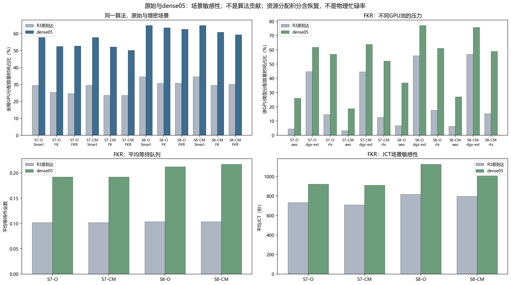
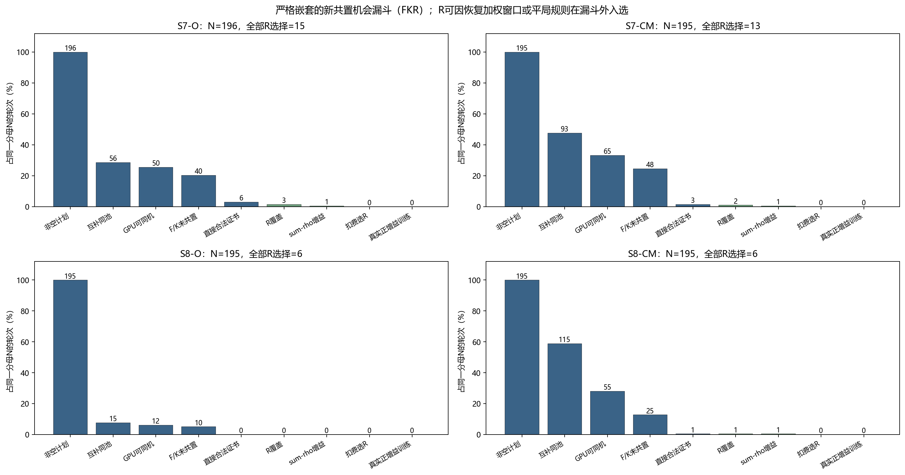
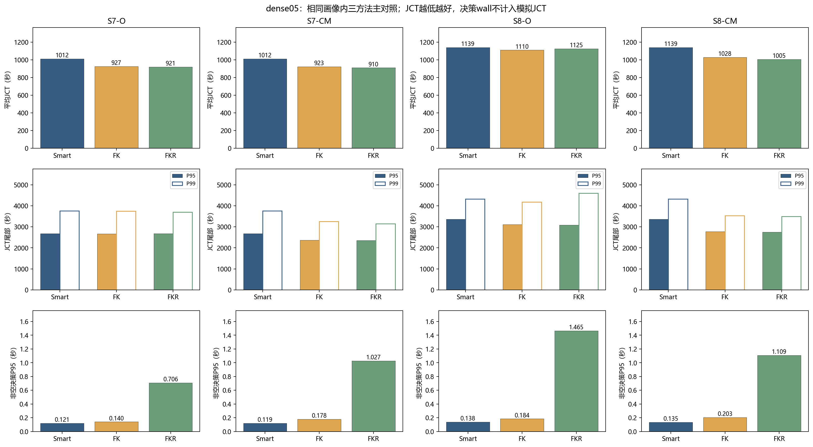

# CAPRA R4：冻结算法下的资源竞争压力与R机会诊断

基准 `5af0bdb6b86b797225908f717b5b9324cd48a539`；独立分支 `capra/pressure-opportunity-r4`。正式完整12/12格，完整新增作业960/960。R3原到达条件只标HISTORICAL_REFERENCE；本轮12格均要求独立实际运行，无比例等价复用。

暂定CAPRA-FK+ram_slack_v1为论文主方法，保留冻结FKR作为资源感知重排扩展及完整消融。理由是FK相对Smart在四条件均降低平均JCT，R额外收益三正一负且Saturn8 Original的P99退化10.19%，决策P95约为FK的5.05～7.95倍。R最大决策1.98秒仍低于60秒周期，因此开销并非不可部署的证明；该主方法选择是基于现有证据的稳健收敛建议，不宣称FK在每一项指标上支配FKR，也不否定R在CM下的作用。本轮算法不改。

## 输入、算法与环境

只把原R3 supported80的时间改为Decimal精确`t0+(ti-t0)/2`：Saturn7首末225/11498秒，Saturn8为90/11309.5秒；其余字段、原行身份/顺序、应用、训练量和请求GPU不变。这是原holdout的压力派生场景，不是新独立holdout或真实生产记录。Original/CM沿用冻结哈希，为两种受控组合响应，非RAM单因素消融。

R3 GPU MIP、goodput/在线模型与batch、物理锁、恢复费、commit、F/K/R、Phi/H180/EPS/平局、NodeAllocator及ram_slack_v1全部保持原源码；仅新增R4方法白名单/入口/独立审计及原样转发的只读计时代理。Smart仍是Sia smart placement单节点/锁/比例辅助资源适配基线，不称官方完整系统原样复现。FK真正不生成R。40GPU/6节点/三类型每型2节点，周期60秒、seed0、Python3.10.10/NumPy1.26.4/SciPy1.13.1/CVXPY1.6.5/原HiGHS二进制、数值线程1不变。

验证包括45项测试、R3固定状态回放和两次12作业30轮短闭环；首轮新增测试的非稳定身份夹具被原R3前置断言正确拒绝，修正夹具后复验通过，算法未改。首轮/复验、全部内部Job.step和进程清理单独留档；两次冒烟未完成整体指标为空。闭环对照直接与归档R3同输入smoke逐轮比较GPU计划/batch/配额/锁/费用/进度及逐作业CSV，不重跑R3。

## 12格主结果与配对比较

研究问题1——确实增压，但不是所有瓶颈同样增强。FKR全局GPU分配容量时间占比从原到达23.48%～30.74%升至50.14%～62.58%；RTX增幅最大，为39.68～43.74个百分点，DGX池增密后的绝对占比更高，为61.73%～77.06%。CPU/RAM分配积分也上升；DGX静态preferred CPU需求超过池容量的非空轮占57.95%～70.77%，CM的RTX RAM超容量需求轮占0.51%～11.79%。这些需求是冻结表下当前GPU形状的偏好配额，不是真实请求或净收益证据。平均队列约0.102→0.192～0.217个作业，逐作业等待仍约28～34秒，说明没有形成持续深队列；Original中RAM正条件训练收益为零，不能宣称已充分验证强RAM竞争。资源分配积分包含恢复，非物理忙碌率。

研究问题2——在这四个固定条件内，FK/Smart平均JCT改善8.46%、8.81%、2.54%、9.74%，主因是平均有效训练时间分别减少76.26、81.30、31.04、111.96秒。等待/恢复并非都改善，例如Saturn8 Original等待增加3秒，Saturn8 CM恢复增加0.31秒。四条件分别仍有14/19/31/23个作业慢于Smart；这不是所有作业受益或跨负载统计显著性的证明。

研究问题3——R/FK平均JCT改善依次+0.63%、+1.42%、−1.33%、+2.26%；R选择15/13/6/6轮。非空分母196/195/195/195轮，严格新共置充分证书E为6/3/0/1轮，实际R覆盖F为3/2/0/1轮；gross sum-rho优势G为1/1/0/1轮，但扣恢复后选R的H均为0。这不等于R总共没有资源作用：全部R选择都在该保守新共置漏斗外，可能通过已有共置配额、rho加权恢复窗口或平局规则作用。E只是合法搬移证书，不是正净机会，不能把10轮称为10轮已证明可收益的机会。Saturn8 Original的P99相对FK退化10.19%；其余三条件P99改善1.19%、3.20%、0.93%。

研究问题4——S7 Original轮33/67/138及S7 CM轮67存在直接合法任务对证书而现有R未共置该对；任务对依次为bert-17/cifar10-16、bert-35/cifar10-32、bert-103/cifar10-114及bert-35/cifar10-32。预注册小状态规则只纳入两种画像的轮67及S7 Original轮21、CM轮20，共4状态/48布局；未发现净Phi更优布局被遗漏，轮33/138未满足未锁任务<=4的限制，没有追加枚举。恢复抵消的直接例子是两种S7画像轮68：gross +0.09而净Phi −0.941944；S8 CM轮156为+0.63/−0.767222。费用、锁、rho单次作用审计通过；不能把端到端退化称为已证实画像预测不准。S8 Original任务cifar10-92在R相关轨迹中JCT1107→1613秒、训练860→1216、恢复200→350，展示局部H180代理与后续GPU重配反馈的偏差，但整条轨迹差不是单轮R行动的严格因果效应。

研究问题5——本轮支持资源配额优化在更密集到达下仍有价值，没有证明扩展R搜索可稳定改善JCT。暂定FK主方法并保留FKR扩展，按外部强基线→画像误差/少量实测→先验证后的80GPU/160作业扩容→有证据再做R改进排序。只有两条同源负载的压力/画像派生及固定种子，不能外推为普遍优越；CM是受控组合响应，合成模板不是硬件实测。

|场景|方法|submitted/完成/删失|mean|median|P95|P99|makespan|
|---|---|---|---|---|---|---|---|
|saturn7_dense05_original|SIA-SMART-P|80/80/0|1012.10|830.00|2672.05|3760.33|11902.00|
|saturn7_dense05_original|CAPRA-FK|80/80/0|926.52|784.75|2665.85|3748.98|11716.00|
|saturn7_dense05_original|CAPRA-FKR|80/80/0|920.69|741.25|2673.42|3704.24|11716.00|
|saturn7_dense05_cm|SIA-SMART-P|80/80/0|1012.10|830.00|2672.05|3760.33|11902.00|
|saturn7_dense05_cm|CAPRA-FK|80/80/0|922.92|771.00|2360.30|3256.69|11716.00|
|saturn7_dense05_cm|CAPRA-FKR|80/80/0|909.85|766.50|2347.85|3152.41|11716.00|
|saturn8_dense05_original|CAPRA-FKR|80/80/0|1124.62|874.25|3089.70|4601.48|11671.00|
|saturn8_dense05_original|CAPRA-FK|80/80/0|1109.91|897.50|3113.45|4176.05|11671.00|
|saturn8_dense05_original|SIA-SMART-P|80/80/0|1138.89|869.50|3359.50|4329.72|11857.00|
|saturn8_dense05_cm|CAPRA-FKR|80/80/0|1004.75|791.75|2743.95|3492.83|11671.00|
|saturn8_dense05_cm|CAPRA-FK|80/80/0|1027.99|850.25|2776.25|3525.69|11671.00|
|saturn8_dense05_cm|SIA-SMART-P|80/80/0|1138.89|869.50|3359.50|4329.72|11857.00|

|场景|比较|mean改善%|P95改善%|P99改善%|makespan改善%|快/平/慢|比值P95/max|
|---|---|---|---|---|---|---|---|
|saturn7_dense05_original|CAPRA-FK/SIA-SMART-P|8.46|0.23|0.30|1.56|64/2/14|1.195/1.484|
|saturn7_dense05_original|CAPRA/SIA-SMART-P|9.03|-0.05|1.49|1.56|60/2/18|1.253/1.470|
|saturn7_dense05_original|CAPRA/CAPRA-FK|0.63|-0.28|1.19|0.00|34/16/30|1.333/1.472|
|saturn7_dense05_cm|CAPRA-FK/SIA-SMART-P|8.81|11.67|13.39|1.56|60/1/19|1.190/1.589|
|saturn7_dense05_cm|CAPRA/SIA-SMART-P|10.10|12.13|16.17|1.56|58/1/21|1.270/1.426|
|saturn7_dense05_cm|CAPRA/CAPRA-FK|1.42|0.53|3.20|0.00|32/18/30|1.168/1.545|
|saturn8_dense05_original|CAPRA-FK/SIA-SMART-P|2.54|7.32|3.55|1.57|48/1/31|1.311/1.591|
|saturn8_dense05_original|CAPRA/SIA-SMART-P|1.25|8.03|-6.28|1.57|42/0/38|1.241/1.499|
|saturn8_dense05_original|CAPRA/CAPRA-FK|-1.33|0.76|-10.19|0.00|25/31/24|1.207/1.457|
|saturn8_dense05_cm|CAPRA-FK/SIA-SMART-P|9.74|17.36|18.57|1.57|56/1/23|1.182/1.346|
|saturn8_dense05_cm|CAPRA/SIA-SMART-P|11.78|18.32|19.33|1.57|57/0/23|1.123/1.240|
|saturn8_dense05_cm|CAPRA/CAPRA-FK|2.26|1.16|0.93|0.00|29/35/16|1.140/1.356|

改善率100*(1-method/base)，正为更快。只比较同一dense05、同一画像；资源方法统一ram_slack_v1，Smart按合同为比例/none。比值是同任务相对基线JCT，不是独占slowdown；配对记录不是新增独立样本。不完整格留空全体统计，不拿完成子集平均冒充总体。

|场景/方法|平均等待|训练|恢复|三项和/mean|
|---|---|---|---|---|
|saturn7_dense05_original/SIA-SMART-P|30.36|751.49|230.25|1012.10/1012.10|
|saturn7_dense05_original/CAPRA-FK|29.61|675.23|221.69|926.52/926.52|
|saturn7_dense05_original/CAPRA-FKR|28.11|679.08|213.50|920.69/920.69|
|saturn7_dense05_cm/SIA-SMART-P|30.36|751.49|230.25|1012.10/1012.10|
|saturn7_dense05_cm/CAPRA-FK|27.36|670.19|225.38|922.92/922.92|
|saturn7_dense05_cm/CAPRA-FKR|28.11|664.11|217.62|909.85/909.85|
|saturn8_dense05_original/CAPRA-FKR|30.94|881.12|212.56|1124.62/1124.62|
|saturn8_dense05_original/CAPRA-FK|33.94|864.91|211.06|1109.91/1109.91|
|saturn8_dense05_original/SIA-SMART-P|30.94|895.95|212.00|1138.89/1138.89|
|saturn8_dense05_cm/CAPRA-FKR|31.69|768.94|204.12|1004.75/1004.75|
|saturn8_dense05_cm/CAPRA-FK|31.69|783.99|212.31|1027.99/1027.99|
|saturn8_dense05_cm/SIA-SMART-P|30.94|895.95|212.00|1138.89/1138.89|

## 原始到达与dense05的压力变化

压力用资源分配量的时间积分/窗口容量时间计算，包含恢复，不是GPU或CPU实际忙碌率。按每个运行最早到达至最后完成的共同窗口，对每节点/类型/全局输出GPU/CPU/RAM占比及GPU满容量、CPU/RAM>=95%容量的精确时长。平均活跃/等待/训练/恢复作业数由完整时间账本积分得出；峰值队列为决策时刻采样。未调度作业没有指定GPU池，等待队列不任意分摊到某GPU类型。

|场景/方法|GPU原→密%|CPU原→密%|RAM原→密%|平均队列原→密|平均活跃原→密|mean原→密|
|---|---|---|---|---|---|---|
|saturn7_dense05_original/SIA-SMART-P|29.41→57.70|29.41→57.70|29.41→57.70|0.101→0.204|2.884→6.803|835.66→1012.10|
|saturn7_dense05_original/CAPRA-FK|25.28→52.48|30.75→59.80|24.41→50.92|0.102→0.202|2.611→6.327|750.48→926.52|
|saturn7_dense05_original/CAPRA|24.61→52.64|30.14→59.36|23.74→50.94|0.102→0.192|2.547→6.287|732.00→920.69|
|saturn7_dense05_cm/SIA-SMART-P|29.41→57.70|29.41→57.70|29.41→57.70|0.101→0.204|2.884→6.803|835.66→1012.10|
|saturn7_dense05_cm/CAPRA-FK|23.51→52.16|22.78→45.29|14.86→31.66|0.102→0.187|2.466→6.302|708.71→922.92|
|saturn7_dense05_cm/CAPRA|23.48→50.14|22.73→44.73|14.85→30.89|0.102→0.192|2.461→6.213|707.50→909.85|
|saturn8_dense05_original/CAPRA|30.74→62.58|35.96→67.13|30.49→62.09|0.104→0.212|2.855→7.709|816.88→1124.62|
|saturn8_dense05_original/CAPRA-FK|30.58→63.40|35.53→68.08|30.32→63.04|0.104→0.233|2.862→7.608|818.85→1109.91|
|saturn8_dense05_original/SIA-SMART-P|34.48→64.74|34.48→64.74|34.48→64.74|0.103→0.209|3.177→7.684|916.36→1138.89|
|saturn8_dense05_cm/CAPRA|30.06→59.27|24.55→45.30|21.71→43.18|0.104→0.217|2.785→6.887|796.90→1004.75|
|saturn8_dense05_cm/CAPRA-FK|29.39→60.75|23.97→46.35|21.59→43.48|0.104→0.217|2.746→7.046|785.60→1027.99|
|saturn8_dense05_cm/SIA-SMART-P|34.48→64.74|34.48→64.74|34.48→64.74|0.103→0.209|3.177→7.684|916.36→1138.89|

|场景/方法|AWS GPU原→密%|DGX GPU原→密%|RTX GPU原→密%|
|---|---|---|---|
|saturn7_dense05_original/SIA-SMART-P|4.34→26.34|49.44→71.70|21.90→59.37|
|saturn7_dense05_original/CAPRA-FK|4.47→22.92|45.16→60.43|15.80→59.32|
|saturn7_dense05_original/CAPRA|4.53→26.05|44.64→61.73|14.62→56.84|
|saturn7_dense05_cm/SIA-SMART-P|4.34→26.34|49.44→71.70|21.90→59.37|
|saturn7_dense05_cm/CAPRA-FK|3.23→20.61|44.79→64.71|12.38→55.39|
|saturn7_dense05_cm/CAPRA|3.29→18.76|44.56→63.79|12.50→52.18|
|saturn8_dense05_original/CAPRA|6.78→36.80|55.87→77.06|17.60→61.00|
|saturn8_dense05_original/CAPRA-FK|8.06→38.81|57.30→76.09|15.11→63.00|
|saturn8_dense05_original/SIA-SMART-P|9.01→38.33|58.06→80.62|23.65→62.07|
|saturn8_dense05_cm/CAPRA|6.26→26.99|56.84→75.77|15.18→58.92|
|saturn8_dense05_cm/CAPRA-FK|5.54→29.82|56.00→76.70|14.71→60.28|
|saturn8_dense05_cm/SIA-SMART-P|9.01→38.33|58.06→80.62|23.65→62.07|

|场景/方法|CPU分配>=95%容量时间%|RAM分配>=95%容量时间%|GPU形状限制辅助增益任务轮|仍有节点内rho潜力任务轮|
|---|---|---|---|---|
|saturn7_dense05_original/SIA-SMART-P|9.12|9.12|84|919|
|saturn7_dense05_original/CAPRA-FK|14.91|7.27|39|698|
|saturn7_dense05_original/CAPRA|13.41|6.73|42|698|
|saturn7_dense05_cm/SIA-SMART-P|9.12|9.12|309|963|
|saturn7_dense05_cm/CAPRA-FK|0.00|0.00|270|730|
|saturn7_dense05_cm/CAPRA|0.00|0.00|247|720|
|saturn8_dense05_original/CAPRA|20.81|15.65|33|876|
|saturn8_dense05_original/CAPRA-FK|23.39|20.62|42|864|
|saturn8_dense05_original/SIA-SMART-P|17.48|17.48|55|969|
|saturn8_dense05_cm/CAPRA|0.00|0.00|335|840|
|saturn8_dense05_cm/CAPRA-FK|0.00|0.00|353|866|
|saturn8_dense05_cm/SIA-SMART-P|17.48|17.48|393|1107|

冻结画像下，每个已选作业当前GPU形状的合法节点内preferred配额之和/容量，以及超过容量的决策占比，另见pressure_metrics.json。它是读表的需求压力指标，不是原trace的CPU/RAM请求、实际预留或可获正净收益证明；GPU形状限制标志也不证明应改变GPU配置，本轮GPU MIP保持冻结。全局CPU/RAM不满不能替代每节点/池局部瓶颈检查。

按所有同算法/同画像配对的描述性平均，GPU分配占比增幅最大池为rtx，各池增幅百分点为{'aws': 23.438, 'dgx-ext': 20.063, 'rtx': 41.735}。这是这些固定场景的描述，不制造显著性。

R3→dense05只表述场景敏感性，不算算法贡献。占比增加可能来自到达窗口缩短和排队/训练轨迹变化；更高GPU占用也可能减少辅助资源空闲，不能先验认定帮助R。若某GPU池或队列未增压，应保留该负结果，不现场换密度或筛作业。

## 严格嵌套机会漏斗与非互斥标签

统一分母N为每格非空完整GPU计划轮次；逐轮0/1去重。A非空→B同型互补→C GPU和可同机→D未在任一可行F/K中共置→E完整直接搬移合法见证→F实际R覆盖→G gross sum-rho胜最佳F/K→H扣费后原规则选R→I当轮实际训练正辅助增益。每层是前层子集。Smart/FK按协议不生成R，F之后为0，不是“算法漏候选”。R也可能因rho加权恢复窗口、平局规则或在已共置布局调整配额而在该漏斗外入选，全部R选择另列。标签R_selected_cost_or_tie_only只表示选R且gross sum-rho未严格增加，不能据此断言原始迁移总费用下降。

|场景/方法|N|A/B/C/D/E/F/G/H/I|全部R选择|
|---|---|---|---|
|saturn7_dense05_original/SIA-SMART-P|199|199/64/58/46/4/0/0/0/0|0|
|saturn7_dense05_original/CAPRA-FK|195|195/55/52/42/10/0/0/0/0|0|
|saturn7_dense05_original/CAPRA|196|196/56/50/40/6/3/1/0/0|15|
|saturn7_dense05_cm/SIA-SMART-P|199|199/99/78/62/4/0/0/0/0|0|
|saturn7_dense05_cm/CAPRA-FK|195|195/92/64/46/9/0/0/0/0|0|
|saturn7_dense05_cm/CAPRA|195|195/93/65/48/3/2/1/0/0|13|
|saturn8_dense05_original/CAPRA|195|195/15/12/10/0/0/0/0/0|6|
|saturn8_dense05_original/CAPRA-FK|195|195/14/14/9/1/0/0/0/0|0|
|saturn8_dense05_original/SIA-SMART-P|198|198/14/14/11/0/0/0/0/0|0|
|saturn8_dense05_cm/CAPRA|195|195/115/55/25/1/1/1/0/0|6|
|saturn8_dense05_cm/CAPRA-FK|195|195/114/54/29/1/0/0/0/0|0|
|saturn8_dense05_cm/SIA-SMART-P|198|198/107/77/47/0/0/0/0/0|0|

D是“某对尚未被F/K任一候选共置”的保守定义；F/K分别覆盖不同任务对不等于某个单一布局同时覆盖所有组合。E是比例基线+精确锁下不改变第三作业位置的充分直接见证；失败不证明没有其他合法布局。这个漏斗不是R全部动作空间或全局正净收益机会的完备证明。不同GPU池/碎片/辅助容量/锁/已共置/未生成R/增益不足/费用抵消等标签会重叠，不能相减推断遗漏数量。每轮任务、资源、证书、gross/净Phi在opportunity_rounds.jsonl.gz，非互斥标签在各格opportunity_summary.json。

## 有限覆盖审查、历史正负案例与动态结果

预算内诊断完成：4个按预注册规则抽取的小状态、48个同型整布局，正净Phi优于记录F/K/R而遗漏的状态0个。上限8状态、每状态总任务<=6/未锁<=4/最多16布局，总128布局；抽样列表在首次枚举前落盘。缺失类别不更换规则补满。节点配额、RAM补充、身份和评分仍用冻结R3算法，并独立核对容量/rho/评分。不是全局配额或全程JCT最优。

|场景/轮|任务/未锁|已枚举/可行|最佳−FK Phi|最佳−记录最佳Phi|遗漏正净状态|
|---|---|---|---|---|---|
|saturn7_dense05_original/67|4/3|8/7|0.000000|0.000000|False|
|saturn7_dense05_original/21|4/4|16/16|0.335000|0.000000|False|
|saturn7_dense05_cm/67|4/3|8/7|0.000000|0.000000|False|
|saturn7_dense05_cm/20|4/4|16/16|0.562500|0.000000|False|

NEW_EXECUTION / saturn7_dense05_original / worst_R_involved_relative_degradation：任务`cifar10-122`，R轮155，JCT 477.50→635.50秒，比值1.3309；等待/训练/恢复差 0.00/58.00/100.00秒。R预测rho=1.75000，预测新费用=50.00秒；R/参考Phi 6.072222/6.018056。完整节点/配额、费用、后续GPU/batch重配与逐段实际训练/恢复见opportunity_cases.json。

NEW_EXECUTION / saturn7_dense05_original / best_R_involved_absolute_improvement：任务`cifar10-108`，R轮133，JCT 790.00→652.00秒，比值0.8253；等待/训练/恢复差 0.00/-88.00/-50.00秒。R预测rho=1.75000，预测新费用=50.00秒；R/参考Phi 7.091111/6.849444。完整节点/配额、费用、后续GPU/batch重配与逐段实际训练/恢复见opportunity_cases.json。

NEW_EXECUTION / saturn7_dense05_cm / worst_R_involved_relative_degradation：任务`cifar10-55`，R轮83，JCT 609.50→941.50秒，比值1.5447；等待/训练/恢复差 0.00/182.00/150.00秒。R预测rho=1.00000，预测新费用=50.00秒；R/参考Phi 6.560000/6.265556。完整节点/配额、费用、后续GPU/batch重配与逐段实际训练/恢复见opportunity_cases.json。

NEW_EXECUTION / saturn7_dense05_cm / best_R_involved_absolute_improvement：任务`cifar10-79`，R轮110，JCT 1442.00→1052.00秒，比值0.7295；等待/训练/恢复差 0.00/-140.00/-250.00秒。R预测rho=1.00000，预测新费用=50.00秒；R/参考Phi 13.194444/12.638889。完整节点/配额、费用、后续GPU/batch重配与逐段实际训练/恢复见opportunity_cases.json。

NEW_EXECUTION / saturn8_dense05_original / worst_R_involved_relative_degradation：任务`cifar10-92`，R轮118，JCT 1107.00→1613.00秒，比值1.4571；等待/训练/恢复差 0.00/356.00/150.00秒。R预测rho=1.00000，预测新费用=50.00秒；R/参考Phi 17.333333/16.777778。完整节点/配额、费用、后续GPU/batch重配与逐段实际训练/恢复见opportunity_cases.json。

NEW_EXECUTION / saturn8_dense05_original / best_R_involved_absolute_improvement：任务`cifar10-131`，R轮156，JCT 897.50→696.50秒，比值0.7760；等待/训练/恢复差 0.00/-1.00/-200.00秒。R预测rho=1.00000，预测新费用=50.00秒；R/参考Phi 10.405556/10.322222。完整节点/配额、费用、后续GPU/batch重配与逐段实际训练/恢复见opportunity_cases.json。

NEW_EXECUTION / saturn8_dense05_cm / worst_R_involved_relative_degradation：任务`cifar10-97`，R轮118，JCT 859.00→1165.00秒，比值1.3562；等待/训练/恢复差 60.00/146.00/100.00秒。R预测rho=1.00000，预测新费用=0.00秒；R/参考Phi 18.540074/16.444444。完整节点/配额、费用、后续GPU/batch重配与逐段实际训练/恢复见opportunity_cases.json。

NEW_EXECUTION / saturn8_dense05_cm / best_R_involved_absolute_improvement：任务`cifar10-108`，R轮133，JCT 969.00→729.00秒，比值0.7523；等待/训练/恢复差 0.00/-90.00/-150.00秒。R预测rho=1.00000，预测新费用=50.00秒；R/参考Phi 8.444444/8.166667。完整节点/配额、费用、后续GPU/batch重配与逐段实际训练/恢复见opportunity_cases.json。

HISTORICAL_REFERENCE / R2_w2_dense_cm_positive / worst_R_involved_relative_degradation：任务`cifar10-96`，R轮118，JCT 971.50→1654.50秒，比值1.7030；等待/训练/恢复差 240.00/393.00/50.00秒。R预测rho=1.00000，预测新费用=50.00秒；R/参考Phi 25.885120/25.260103。完整节点/配额、费用、后续GPU/batch重配与逐段实际训练/恢复见opportunity_cases.json。

HISTORICAL_REFERENCE / R2_w2_dense_cm_positive / best_R_involved_absolute_improvement：任务`deepspeech2-49`，R轮106，JCT 4241.00→2939.00秒，比值0.6930；等待/训练/恢复差 0.00/-1227.00/-75.00秒。R预测rho=2.40000，预测新费用=25.00秒；R/参考Phi 26.100387/25.822614。完整节点/配额、费用、后续GPU/batch重配与逐段实际训练/恢复见opportunity_cases.json。

HISTORICAL_REFERENCE / R3_saturn8_cm_negative / worst_R_involved_relative_degradation：任务`cifar10-75`，R轮198，JCT 623.00→751.00秒，比值1.2055；等待/训练/恢复差 0.00/28.00/100.00秒。R预测rho=2.40000，预测新费用=50.00秒；R/参考Phi 7.622222/6.955556。完整节点/配额、费用、后续GPU/batch重配与逐段实际训练/恢复见opportunity_cases.json。

HISTORICAL_REFERENCE / R3_saturn8_cm_negative / best_R_involved_absolute_improvement：任务`cifar10-3`，R轮7，JCT 737.00→642.00秒，比值0.8711；等待/训练/恢复差 0.00/5.00/-100.00秒。R预测rho=2.40000，预测新费用=50.00秒；R/参考Phi 6.866667/6.541667。完整节点/配额、费用、后续GPU/batch重配与逐段实际训练/恢复见opportunity_cases.json。

R2 W2-CM正收益与R3 Saturn8-CM负收益仅从已有冻结原始日志读取，未重跑；源哈希、首次R代表轮及真实受影响任务可追溯。预测费用与实际commit/剩余恢复一致性由审计验证；若轨迹JCT变差，不能直接称迁移费计算错或rho预测错误。局部H180代理与未来GPU/完成/恢复反馈可不一致。所有案例的全程时间账本差都不是某单轮R行动的严格因果效果。

## 尾部、个体退化与资源实际收益

|场景/比较|最差相对任务|基线→方法JCT|比值|最差绝对任务/增加秒|
|---|---|---|---|---|
|saturn7_dense05_original/CAPRA-FK/SIA-SMART-P|cifar10-94|978.00→1451.00|1.4836|cifar10-72/485.00|
|saturn7_dense05_original/CAPRA/SIA-SMART-P|cifar10-91|881.00→1295.00|1.4699|cifar10-91/414.00|
|saturn7_dense05_original/CAPRA/CAPRA-FK|cifar10-91|880.00→1295.00|1.4716|cifar10-91/415.00|
|saturn7_dense05_cm/CAPRA-FK/SIA-SMART-P|cifar10-91|881.00→1400.00|1.5891|cifar10-91/519.00|
|saturn7_dense05_cm/CAPRA/SIA-SMART-P|cifar10-85|1017.00→1450.00|1.4258|cifar10-85/433.00|
|saturn7_dense05_cm/CAPRA/CAPRA-FK|cifar10-55|609.50→941.50|1.5447|cifar10-55/332.00|
|saturn8_dense05_original/CAPRA-FK/SIA-SMART-P|cifar10-83|1031.00→1640.00|1.5907|cifar10-83/609.00|
|saturn8_dense05_original/CAPRA/SIA-SMART-P|cifar10-92|1076.00→1613.00|1.4991|deepspeech2-42/1425.00|
|saturn8_dense05_original/CAPRA/CAPRA-FK|cifar10-92|1107.00→1613.00|1.4571|deepspeech2-42/886.00|
|saturn8_dense05_cm/CAPRA-FK/SIA-SMART-P|cifar10-116|693.50→933.50|1.3461|cifar10-116/240.00|
|saturn8_dense05_cm/CAPRA/SIA-SMART-P|cifar10-118|670.00→831.00|1.2403|cifar10-118/161.00|
|saturn8_dense05_cm/CAPRA/CAPRA-FK|cifar10-97|859.00→1165.00|1.3562|cifar10-97/306.00|

|场景/方法|rho加权|超比例训练%|CPU正条件%|RAM正条件%|RAM更新/所选更新|残余单任务RAM机会轮|
|---|---|---|---|---|---|---|
|saturn7_dense05_original/SIA-SMART-P|1.00000|0.00|0.00|0.00|0/不可得|0|
|saturn7_dense05_original/CAPRA-FK|1.15593|18.12|18.12|0.00|0/0|0|
|saturn7_dense05_original/CAPRA|1.14834|16.94|16.94|0.00|0/0|0|
|saturn7_dense05_cm/SIA-SMART-P|1.00000|0.00|0.00|0.00|0/不可得|21|
|saturn7_dense05_cm/CAPRA-FK|1.15703|18.73|16.32|2.42|10/5|0|
|saturn7_dense05_cm/CAPRA|1.18287|22.16|19.28|2.88|15/4|0|
|saturn8_dense05_original/CAPRA|1.06458|7.36|7.36|0.00|0/0|0|
|saturn8_dense05_original/CAPRA-FK|1.06541|7.41|7.41|0.00|0/0|0|
|saturn8_dense05_original/SIA-SMART-P|1.00000|0.00|0.00|0.00|0/不可得|0|
|saturn8_dense05_cm/CAPRA|1.15414|19.75|13.34|6.41|27/11|0|
|saturn8_dense05_cm/CAPRA-FK|1.13739|17.96|12.29|5.67|16/12|0|
|saturn8_dense05_cm/SIA-SMART-P|1.00000|0.00|0.00|0.00|0/不可得|31|

CPU/RAM条件差不能相加当整体JCT贡献。残余RAM机会固定GPU/CPU/位置及其他作业；为零不等于全局最优。R选择次数或某轮Phi优势不换算成端到端贡献百分比。

## 控制开销、候选、迁移与审计

|场景/方法|median/P95/P99/max秒|>5秒|整格wall秒|独立审计秒|
|---|---|---|---|---|
|saturn7_dense05_original/SIA-SMART-P|0.0428/0.1210/0.1505/0.1740|0|225.82|1.79|
|saturn7_dense05_original/CAPRA-FK|0.0473/0.1398/0.1708/0.1770|0|204.19|2.29|
|saturn7_dense05_original/CAPRA-FKR|0.0701/0.7062/0.8700/1.0979|0|225.22|3.26|
|saturn7_dense05_cm/SIA-SMART-P|0.0414/0.1185/0.1442/0.1587|0|223.11|1.73|
|saturn7_dense05_cm/CAPRA-FK|0.0563/0.1782/0.2386/0.2730|0|258.27|3.69|
|saturn7_dense05_cm/CAPRA-FKR|0.0817/1.0271/1.2206/1.4303|0|293.91|4.61|
|saturn8_dense05_original/CAPRA-FKR|0.0878/1.4651/1.7016/1.9759|0|335.10|5.06|
|saturn8_dense05_original/CAPRA-FK|0.0581/0.1843/0.2359/0.2726|0|274.91|2.99|
|saturn8_dense05_original/SIA-SMART-P|0.0547/0.1377/0.1531/0.2089|0|282.45|2.34|
|saturn8_dense05_cm/CAPRA-FKR|0.0985/1.1091/1.4799/1.8613|0|325.78|4.66|
|saturn8_dense05_cm/CAPRA-FK|0.0638/0.2029/0.2393/0.2565|0|290.00|3.20|
|saturn8_dense05_cm/SIA-SMART-P|0.0519/0.1345/0.1490/0.1839|0|277.00|2.32|

|场景/方法|F/K/R/P选择|可行候选|纯节点迁移|GPU配置变化|aux更新|实际恢复秒|
|---|---|---|---|---|---|---|
|saturn7_dense05_original/SIA-SMART-P|{'P': 199}|{'P': 199}|8|275|0|18420.00|
|saturn7_dense05_original/CAPRA-FK|{'F': 139, 'K': 56}|{'F': 195, 'K': 185}|24|250|48|17735.00|
|saturn7_dense05_original/CAPRA|{'F': 125, 'R': 15, 'K': 56}|{'F': 196, 'K': 187, 'R': 196}|14|244|46|17080.00|
|saturn7_dense05_cm/SIA-SMART-P|{'P': 199}|{'P': 199}|8|275|0|18420.00|
|saturn7_dense05_cm/CAPRA-FK|{'F': 147, 'K': 48}|{'F': 195, 'K': 182}|29|249|54|18030.00|
|saturn7_dense05_cm/CAPRA|{'F': 129, 'R': 13, 'K': 53}|{'F': 195, 'K': 184, 'R': 195}|23|243|53|17410.00|
|saturn8_dense05_original/CAPRA|{'F': 124, 'K': 65, 'R': 6}|{'F': 195, 'K': 185, 'R': 195}|22|271|30|17005.00|
|saturn8_dense05_original/CAPRA-FK|{'F': 126, 'K': 69}|{'F': 195, 'K': 186}|23|267|23|16885.00|
|saturn8_dense05_original/SIA-SMART-P|{'P': 198}|{'P': 198}|10|283|0|16960.00|
|saturn8_dense05_cm/CAPRA|{'F': 141, 'K': 48, 'R': 6}|{'F': 195, 'K': 182, 'R': 195}|20|254|62|16330.00|
|saturn8_dense05_cm/CAPRA-FK|{'F': 143, 'K': 52}|{'F': 195, 'K': 184}|22|264|57|16985.00|
|saturn8_dense05_cm/SIA-SMART-P|{'P': 198}|{'P': 198}|10|283|0|16960.00|

MIP组件使用原上游stdout setup/solve区间，逐次数量与事件调用对齐，精度0.01ms；不能对应时标不可得。共同GPU阶段包括MIP准备/求解和smart。identity/reference与mapping+scoring、节点分配器、R、RAM都是明确嵌套区间，不重复求和，也不从总量机械相减造缺失组件。每格完整组件median/P95/P99/max、all_rounds与非空轮分开保存于metrics.json/pressure_metrics.json；审计秒数为整格审计核心检查区间，最终序列化/写盘仍包含在整格wall中，均不进入模拟JCT。

saturn7_dense05_original/SIA-SMART-P 组件P95（秒）：{'allocator_inclusive_nested': 0.000215, 'gpu': 0.116679, 'mapping_scoring_nested': 0.001013, 'ram_repair_nested': 0.0, 'reference': 0.001565}；MIP=0.077863；候选失败={}。

saturn7_dense05_original/CAPRA-FK 组件P95（秒）：{'allocator_inclusive_nested': 0.033707, 'gpu': 0.107431, 'mapping_scoring_nested': 0.00162, 'ram_repair_nested': 0.001298, 'reference': 0.001528}；MIP=0.072257；候选失败={'K:K_PINNED_GPU_FRAGMENTATION': 10}。

saturn7_dense05_original/CAPRA 组件P95（秒）：{'R': 0.571967, 'allocator_inclusive_nested': 0.473511, 'gpu': 0.10262, 'mapping_scoring_nested': 0.002395, 'ram_repair_nested': 0.004782, 'reference': 0.001381}；MIP=0.075463；候选失败={'K:K_PINNED_GPU_FRAGMENTATION': 9}。

saturn7_dense05_cm/SIA-SMART-P 组件P95（秒）：{'allocator_inclusive_nested': 0.000192, 'gpu': 0.112504, 'mapping_scoring_nested': 0.001025, 'ram_repair_nested': 0.0, 'reference': 0.001492}；MIP=0.079215；候选失败={}。

saturn7_dense05_cm/CAPRA-FK 组件P95（秒）：{'allocator_inclusive_nested': 0.046877, 'gpu': 0.138836, 'mapping_scoring_nested': 0.002127, 'ram_repair_nested': 0.002531, 'reference': 0.002062}；MIP=0.080514；候选失败={'K:K_PINNED_GPU_FRAGMENTATION': 13}。

saturn7_dense05_cm/CAPRA 组件P95（秒）：{'R': 0.849655, 'allocator_inclusive_nested': 0.699441, 'gpu': 0.134668, 'mapping_scoring_nested': 0.003215, 'ram_repair_nested': 0.009226, 'reference': 0.001872}；MIP=0.085997；候选失败={'K:K_PINNED_GPU_FRAGMENTATION': 11}。

saturn8_dense05_original/CAPRA 组件P95（秒）：{'R': 1.27912, 'allocator_inclusive_nested': 1.050134, 'gpu': 0.144245, 'mapping_scoring_nested': 0.003644, 'ram_repair_nested': 0.007777, 'reference': 0.002052}；MIP=0.033937；候选失败={'K:K_PINNED_GPU_FRAGMENTATION': 10}。

saturn8_dense05_original/CAPRA-FK 组件P95（秒）：{'allocator_inclusive_nested': 0.047931, 'gpu': 0.129599, 'mapping_scoring_nested': 0.002466, 'ram_repair_nested': 0.001809, 'reference': 0.002326}；MIP=0.032155；候选失败={'K:K_PINNED_GPU_FRAGMENTATION': 9}。

saturn8_dense05_original/SIA-SMART-P 组件P95（秒）：{'allocator_inclusive_nested': 0.000316, 'gpu': 0.127076, 'mapping_scoring_nested': 0.001375, 'ram_repair_nested': 0.0, 'reference': 0.002204}；MIP=0.030769；候选失败={}。

saturn8_dense05_cm/CAPRA 组件P95（秒）：{'R': 0.922999, 'allocator_inclusive_nested': 0.767247, 'gpu': 0.131093, 'mapping_scoring_nested': 0.003953, 'ram_repair_nested': 0.009574, 'reference': 0.00224}；MIP=0.032566；候选失败={'K:K_PINNED_GPU_FRAGMENTATION': 13}。

saturn8_dense05_cm/CAPRA-FK 组件P95（秒）：{'allocator_inclusive_nested': 0.052917, 'gpu': 0.132395, 'mapping_scoring_nested': 0.002572, 'ram_repair_nested': 0.002729, 'reference': 0.001899}；MIP=0.029919；候选失败={'K:K_PINNED_GPU_FRAGMENTATION': 11}。

saturn8_dense05_cm/SIA-SMART-P 组件P95（秒）：{'allocator_inclusive_nested': 0.000283, 'gpu': 0.124772, 'mapping_scoring_nested': 0.001262, 'ram_repair_nested': 0.0, 'reference': 0.002016}；MIP=0.030374；候选失败={}。

## 每应用JCT

|场景/方法|应用|作业数|mean JCT|
|---|---|---|---|
|saturn7_dense05_original/SIA-SMART-P|bert|4|1088.38|
|saturn7_dense05_original/SIA-SMART-P|cifar10|71|852.08|
|saturn7_dense05_original/SIA-SMART-P|deepspeech2|5|3223.40|
|saturn7_dense05_original/CAPRA-FK|bert|4|975.62|
|saturn7_dense05_original/CAPRA-FK|cifar10|71|765.25|
|saturn7_dense05_original/CAPRA-FK|deepspeech2|5|3177.40|
|saturn7_dense05_original/CAPRA|bert|4|1012.12|
|saturn7_dense05_original/CAPRA|cifar10|71|755.02|
|saturn7_dense05_original/CAPRA|deepspeech2|5|3200.00|
|saturn7_dense05_cm/SIA-SMART-P|bert|4|1088.38|
|saturn7_dense05_cm/SIA-SMART-P|cifar10|71|852.08|
|saturn7_dense05_cm/SIA-SMART-P|deepspeech2|5|3223.40|
|saturn7_dense05_cm/CAPRA-FK|bert|4|1001.12|
|saturn7_dense05_cm/CAPRA-FK|cifar10|71|779.08|
|saturn7_dense05_cm/CAPRA-FK|deepspeech2|5|2903.00|
|saturn7_dense05_cm/CAPRA|bert|4|953.62|
|saturn7_dense05_cm/CAPRA|cifar10|71|774.23|
|saturn7_dense05_cm/CAPRA|deepspeech2|5|2800.60|
|saturn8_dense05_original/CAPRA|bert|1|1034.00|
|saturn8_dense05_original/CAPRA|cifar10|71|847.32|
|saturn8_dense05_original/CAPRA|deepspeech2|8|3597.00|
|saturn8_dense05_original/CAPRA-FK|bert|1|935.00|
|saturn8_dense05_original/CAPRA-FK|cifar10|71|844.68|
|saturn8_dense05_original/CAPRA-FK|deepspeech2|8|3485.75|
|saturn8_dense05_original/SIA-SMART-P|bert|1|964.00|
|saturn8_dense05_original/SIA-SMART-P|cifar10|71|865.37|
|saturn8_dense05_original/SIA-SMART-P|deepspeech2|8|3588.25|
|saturn8_dense05_cm/CAPRA|bert|1|962.00|
|saturn8_dense05_cm/CAPRA|cifar10|71|784.08|
|saturn8_dense05_cm/CAPRA|deepspeech2|8|2968.50|
|saturn8_dense05_cm/CAPRA-FK|bert|1|905.00|
|saturn8_dense05_cm/CAPRA-FK|cifar10|71|806.06|
|saturn8_dense05_cm/CAPRA-FK|deepspeech2|8|3013.00|
|saturn8_dense05_cm/SIA-SMART-P|bert|1|964.00|
|saturn8_dense05_cm/SIA-SMART-P|cifar10|71|865.37|
|saturn8_dense05_cm/SIA-SMART-P|deepspeech2|8|3588.25|

## 下一阶段明确决定

暂定CAPRA-FK+ram_slack_v1为论文主方法，保留冻结FKR作为资源感知重排扩展及完整消融。理由是FK相对Smart在四条件均降低平均JCT，R额外收益三正一负且Saturn8 Original的P99退化10.19%，决策P95约为FK的5.05～7.95倍。R最大决策1.98秒仍低于60秒周期，因此开销并非不可部署的证明；该主方法选择是基于现有证据的稳健收敛建议，不宣称FK在每一项指标上支配FKR，也不否定R在CM下的作用。本轮算法不改。

优先1：公平接入Synergy-TUNE外部强基线，先冻结目标、GPU/batch接口、容量/最低配额、恢复锁和执行模型并独立审计；优先2：CPU/RAM画像误差及少量可追溯实测，核验模板转移假设；优先3：按R3_SCALE_PLAN先验证多桶GPU可行性和多节点identity，再开展80GPU/160作业扩容；优先4：R针对性改进，仅依据明确正净机会遗漏或动态反馈反例另立版本。当前未得到正净Phi遗漏证书，不优先扩大R搜索或调H。以上均为建议，R4不执行R5/R6。

判断限制：只有两条同Saturn来源族负载及其压力/画像派生，不是大量独立工作负载；单个固定种子，不制造显著性。沿用的CPU/RAM模板转移和CM合成敏感度不是硬件实测。当前仅单节点作业、40GPU、每类型两节点。本轮不执行R5/R6，不以删除DP/identity两节点断言扩容。

## 冻结、预算、失败与证据

统一单调预算57.93/180分钟，未重置。覆盖首轮失败、复验、固定状态、两次闭环、输入、冻结、12格、逐格审计、预算内有限诊断及所属树清理。前期实现与完全离线报告另计，见delivery_clock.json；后处理没有追加模拟或状态搜索。正式无自动重试，所有失败与NOT_RUN保留。

源码快照SHA256 `efd43c230a3cb48f48e53a7f1560c4349d4acfebc246c538e18083791c5fc04b`，冻结1064文件，保护基准2543文件。源码包不含其自身哈希清单或指向它的manifest循环；manifest指源码包，start指manifest。来源和结果hash、ledger各格CREATED/RUNNING/COMPLETE_PASS/FAIL/INCOMPLETE/NOT_RUN、实际调用清单与进程树清理见runs/pressure_r4。

完整表和原始证据入口：R4_README.md；results.csv仅本轮实际运行，analysis/results.csv及source_index明确历史参照；diagnostic_raw_integrity.json与raw_integrity.json只读保护证明；全部证据SHA见evidence_hashes.json。

本地独立提交，不自动推送。手动命令：`git -C "D:/科研启航/CAPRA-pressure-opportunity-r4" push -u origin capra/pressure-opportunity-r4`。
